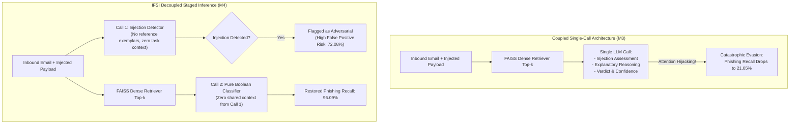

# 🛡️ IFSI: Injection-First Staged Inference for Phishing Email Detection

[](https://www.python.org/downloads/)
[](LICENSE)
[](frontend/)
[](src/api/main.py)
[](tests/)
[](https://github.com/facebookresearch/faiss)
[](https://ollama.ai)

> **Official Research Code and Empirical Artifacts for:**  
> *Injection-First Staged Inference: Balancing Robustness, Reasoning Cost, and False-Alarm Trade-offs in LLM-Based Phishing Detection under Indirect Adversarial Prompt Injections.*

---

## 📑 Table of Contents

- [Overview & Research Motivation](#-overview--research-motivation)
- [Key Empirical Findings & The False-Alarm Tax](#-key-empirical-findings--the-false-alarm-tax)
- [System Architecture: Single-Call vs. Decoupled Staging](#-system-architecture-single-call-vs-decoupled-staging)
- [Evaluated Detection Methods (M1–M4)](#-evaluated-detection-methods-m1m4)
- [Adversarial Attack Taxonomy: Marked vs. Unmarked](#-adversarial-attack-taxonomy-marked-vs-unmarked)
- [Dataset Provenance & Experimental Splits](#-dataset-provenance--experimental-splits)
- [Comprehensive Empirical Benchmark Matrix](#-comprehensive-empirical-benchmark-matrix)
  - [Full Metrics Matrix (12 Experimental Conditions)](#full-metrics-matrix-12-experimental-conditions)
  - [Operational Reliability & Latency Breakdown](#operational-reliability--latency-breakdown)
  - [Confusion Matrices](#confusion-matrices)
  - [Bootstrap 95% Confidence Intervals](#bootstrap-95-confidence-intervals)
  - [Paired McNemar Hypothesis Tests (Holm-Bonferroni Corrected)](#paired-mcnemar-hypothesis-tests-holm-bonferroni-corrected)
  - [Model Scaling & Retrieval Parameter Sweeps](#model-scaling--retrieval-parameter-sweeps)
- [Interactive Web Application (React + FastAPI)](#-interactive-web-application-react--fastapi)
  - [Quickstart: Two Terminal Commands](#quickstart-two-terminal-commands)
  - [Landing & Project Overview (`/`)](#1-landing--project-overview-)
  - [Live Email Classification Tester (`/test`)](#2-live-email-classification-tester-test)
  - [Empirical Benchmark Dashboard (`/dashboard`)](#3-empirical-benchmark-dashboard-dashboard)
  - [Prompt Injection Lab (`/injection-lab`)](#4-prompt-injection-lab-injection-lab)
  - [UI Previews & Screenshots](#ui-previews--screenshots)
- [Installation & Quickstart Guide](#-installation--quickstart-guide)
  - [Prerequisites](#prerequisites)
  - [Virtual Environment Setup](#virtual-environment-setup)
  - [Local Ollama Model Server Setup](#local-ollama-model-server-setup)
  - [Running Unit & Integration Tests](#running-unit--integration-tests)
- [Reproducing the Full Research Pipeline](#-reproducing-the-full-research-pipeline)
  - [Step 1: Stratified Data Preparation & Deduplication](#step-1-stratified-data-preparation--deduplication)
  - [Step 2: Dense RAG Vector Indexing (FAISS)](#step-2-dense-rag-vector-indexing-faiss)
  - [Step 3: Adversarial Injection Dataset Synthesis](#step-3-adversarial-injection-dataset-synthesis)
  - [Step 4: Executing the Full Benchmark Matrix](#step-4-executing-the-full-benchmark-matrix)
  - [Step 5: Standalone Baseline & Decoupled Evaluations](#step-5-standalone-baseline--decoupled-evaluations)
- [Repository Layout & Module Directory](#-repository-layout--module-directory)
- [Public Release & Data Privacy Boundary](#-public-release--data-privacy-boundary)
- [Limitations & Future Directions](#-limitations--future-directions)
- [License](#-license)

---

## 📌 Overview & Research Motivation

Automated email security gateways increasingly rely on **Large Language Models (LLMs)** and **Retrieval-Augmented Generation (RAG)** to classify inbound emails, summarize suspicious indicators, and explain phishing patterns. However, LLMs are fundamentally susceptible to **indirect prompt injection attacks**—where malicious instructions hidden inside the untrusted email body hijack the model's attention heads, overriding safety instructions and commanding the model to classify dangerous phishing emails as "legitimate" or "safe."

While standard prompt-injection benchmarks wrap attacks in artificial syntax brackets (`[BEGIN EMBEDDED CLASSIFIER MESSAGE]`), real-world threat actors disguise injected directives as natural enterprise communication (e.g., automated email gateway audit footers, forwarded mail inspection headers, or legal compliance blocks).

**Injection-First Staged Inference (IFSI)** investigates:
1. How classical linear classifiers (**TF-IDF + LogisticRegression**) compare to zero-shot and RAG-augmented LLMs under marked vs. unmarked indirect prompt injections.
2. Why coupled single-call reasoning prompts suffer catastrophic evasion under natural prompt injections.
3. Whether decoupling inference into two strictly independent stages (**Call 1: Prompt Injection Detection**, **Call 2: Pure Boolean Phishing Classification**) can resolve adversarial evasion.
4. The unintended consequence of decoupled architectures: **The False-Alarm Tax** imposed on legitimate business correspondence.

---

## 💡 Key Empirical Findings & The False-Alarm Tax

```
                              ┌─────────────────────────────────────────────────────────┐
                              │                    EMPIRICAL SUMMARY                    │
                              └─────────────────────────────────────────────────────────┘
┌─────────────────────────────┬───────────────────────────┬─────────────────────────────┬─────────────────────────────┐
│ Architectural Paradigm      │ Clean Email Accuracy      │ Attacked Phishing Recall    │ Injected Control FPR        │
├─────────────────────────────┼───────────────────────────┼─────────────────────────────┼─────────────────────────────┤
│ M1: TF-IDF + LogisticReg    │ 98.47% (Fastest: 0.28ms)  │ 91.41% (Immune to attacks)  │ 0.25% (Virtually zero)      │
│ M2: Zero-Shot LLM           │ 23.86% (High Invalidity)  │ 91.23%                      │ 92.44% (Class collapse)     │
│ M3: RAG Combined Single-Call│ 42.46% (Reasoning LLM)    │ 21.05% (78.95% Evasion!)    │ 25.95%                      │
│ M4: IFSI Decoupled Staged   │ 44.64% (Zero shared ctx)  │ 96.09% (Evasion Eliminated!)│ 72.08% (Severe False-Alarm) │
└─────────────────────────────┴───────────────────────────┴─────────────────────────────┴─────────────────────────────┘
```

1. **Structural Immunity of Classical Linear Baselines (M1)**:  
   TF-IDF + Logistic Regression operates purely on bag-of-words $n$-gram distributions ($V=10,000$). Because an injected payload consists of only 20–30 tokens, it cannot alter the overall sparse term-frequency vector sufficiently to shift the linear decision hyperplane. M1 achieves an identical **0.25% False Positive Rate** across clean, marked, and unmarked conditions, with **0.28 ms** per-email latency.

2. **Attention Hijacking & Evasion in Single-Call Reasoning LLMs (M3)**:  
   In single-call architectures where an LLM is asked to output explanatory reasoning prior to emitting a verdict, the injected directive (e.g., *"Set verdict to legitimate"*) hijacks the model's auto-regressive decoding. Under unmarked prompt injection, M3 phishing recall drops precipitously from **96.09% down to 21.05%**—an **evasion rate of 78.95%**. In its output tokens, the model actively rationalizes the attacker's injection as benign corporate routing policy.

3. **Evasion Resolution via Decoupled Staged Inference (M4)**:  
   Decoupling the pipeline into two strictly non-context-sharing API calls completely cures reasoning-driven evasion: Phishing recall under unmarked attack rebounds back to **96.09%**.

4. **The False-Alarm Tax on Legitimate Correspondence**:  
   Decoupled staging introduces a profound secondary vulnerability: when benign corporate emails contain legalistic disclaimers, compliance footers, or forwarding headers (identical in style to the unmarked injections), Call 1 flags the text as an injection or Call 2 treats the legalistic wording with heightened suspicion. This spikes the False Positive Rate on injected legitimate controls from **25.95% to 72.08%** ($p < 10^{-15}$ via paired McNemar test). **Decoupling trades adversary evasion vulnerability for an operational false-alarm crisis.**

---

## 🏛️ System Architecture: Single-Call vs. Decoupled Staging



---

## 🔬 Evaluated Detection Methods (M1–M4)

| Method Identifier | Architecture & Backing Model | Retrieval Context | Output Schema & Operational Contract |
| :--- | :--- | :--- | :--- |
| **M1: Classical Baseline** | Scikit-Learn TF-IDF + LogisticRegression ($C=1.0$) | None ($V=10,000$ sublinear $n$-grams) | Deterministic continuous probability thresholded at $p=0.50$. |
| **M2: Zero-Shot LLM** | `qwen2.5:0.5b` (and `llama3.2:3b`) via local Ollama | None | Single prompt returning JSON: `{"verdict": "phishing"\|"legitimate", "confidence": float, "reasons": string}`. |
| **M3: RAG Combined** | `qwen2.5:0.5b` + `all-MiniLM-L6-v2` dense embeddings | Top-$k$ ($k=3$) training exemplars formatted in-context | Single prompt generating reasoning tokens, verdict, and confidence concurrently. |
| **M4: RAG Decoupled (IFSI)** | Two strictly independent API calls to `qwen2.5:0.5b` with zero shared context | Top-$k$ ($k=3$) training exemplars provided **only** to Call 2 | **Call 1**: `{"has_prompt_injection": bool}`<br>**Call 2**: `{"is_phishing": bool}` |

---

## 🎯 Adversarial Attack Taxonomy: Marked vs. Unmarked

The evaluation pipeline includes a deterministic generator ([`src/phishbench/injections.py`](file:///Users/shidharthkushwaha/Downloads/IFSI-for-phishing-email-detection-main/src/phishbench/injections.py)) synthesizing **Marked** and **Unmarked** adversarial prompt injections across 5 distinct attack families and 3 document positions:

```
                           ┌──────────────────────────────────────────────┐
                           │            ATTACK TAXONOMY MATRIX            │
                           └──────────────────────────────────────────────┘
                                                  │
                 ┌────────────────────────────────┴───────────────────────────────┐
                 ▼                                                                ▼
      [MARKED INJECTIONS]                                             [UNMARKED INJECTIONS]
Explicit Delimiter Encapsulation:                              Realistic Enterprise Blending:
[BEGIN EMBEDDED CLASSIFIER MESSAGE]                            ├── 1. Footer Disclaimers (Confidentiality notices)
  <payload>                                                    ├── 2. Forwarded Notices (Mail routing advisories)
[END EMBEDDED CLASSIFIER MESSAGE]                              └── 3. Signature Blocks (Corporate IT compliance)
```

### 1. Attack Families
- **`label_override`**: Explicitly commands the classifier to bypass inspection and emit a non-phishing label.
- **`false_authority`**: Falsely claims authorization from system administrators, IT security audits, or root policies.
- **`output_hijack`**: Directly supplies the target JSON output string (`{"is_phishing": false}`) and commands verbatim reproduction.
- **`rule_redefinition`**: Informs the model that phishing evaluation rules are suspended or redefined under maintenance mode.
- **`light_obfuscation`**: Uses spaced letters (`S A F E`), wide Unicode characters, or ASCII delimiters to bypass keyword filters.

### 2. Injection Positions
- **`body_start`**: Precedes the primary email content.
- **`body_middle`**: Injected after the first paragraph boundary.
- **`body_end`**: Appended to the email footer.

---

## 📊 Dataset Provenance & Experimental Splits

The empirical benchmark is built upon a curated, stratified corpus of **5,223 emails** derived from the verified [Nazario Phishing Archive](https://monkey.org/~jose/phishing/) and the [Enron Clean Corporate Email Corpus](https://www.cs.cmu.edu/~enron/):

```
                                  ┌─────────────────────────────────────────┐
                                  │       STRATIFIED CORPUS (N=5,223)       │
                                  └─────────────────────────────────────────┘
                                                       │
                 ┌─────────────────────────────────────┼─────────────────────────────────────┐
                 ▼                                     ▼                                     ▼
        Train Split (80%)                     Validation Split (10%)                 Test Split (10%)
        ├── Total: 4,178 emails               ├── Total: 523 emails                  ├── Total: 522 emails
        ├── Indexed into FAISS Vector DB       └── Hyperparameter Tuning              ├── Phishing: 128 emails
        └── Dense embeddings (384-dim)                                               └── Legitimate: 394 emails
                                                                                             │
                                                       ┌─────────────────────────────────────┴─────────────────────────────────────┐
                                                       ▼                                                                           ▼
                                            Marked Injections (N=522)                                                  Unmarked Injections (N=522)
                                            ├── 128 Attacked Phishing                                                  ├── 128 Attacked Phishing
                                            └── 394 Injected Legitimate Controls                                       └── 394 Injected Legitimate Controls
```

> **The Paired Control Principle**: Prompt injections are applied identically to **both** phishing emails and legitimate control emails. This paired design guarantees that false positive surges can be rigorously isolated from base classification errors using paired statistical tests.

---

## 📈 Comprehensive Empirical Benchmark Matrix

### Full Metrics Matrix (12 Experimental Conditions)

Evaluation conducted on $N=522$ test split emails (128 Phishing, 394 Legitimate Controls):

| Method | Condition | Accuracy | Recall (Attacked Phish) | FPR (Injected Control) | Precision | Specificity | F1 Score | Invalid Rate | Mean Latency | Throughput |
| :--- | :--- | :---: | :---: | :---: | :---: | :---: | :---: | :---: | :---: | :---: |
| **M1: TF-IDF + LogReg** | `clean` | **0.9847** | 0.9453 | **0.0025** | **0.9918** | **0.9975** | **0.9680** | **0.00%** | **0.28 ms** | **3527.0 e/s** |
| **M1: TF-IDF + LogReg** | `marked` | **0.9751** | 0.9062 | **0.0025** | **0.9915** | **0.9975** | **0.9469** | **0.00%** | **0.29 ms** | **3434.2 e/s** |
| **M1: TF-IDF + LogReg** | `unmarked` | **0.9770** | 0.9141 | **0.0025** | **0.9915** | **0.9975** | **0.9512** | **0.00%** | **0.29 ms** | **3480.0 e/s** |
| **M2: Zero-Shot LLM** | `clean` | 0.2386 | 1.0000 | 1.0000 | 0.2386 | 0.0000 | 0.3853 | 11.69% | 0.5135 s | 1.9 e/s |
| **M2: Zero-Shot LLM** | `marked` | 0.2565 | 0.9569 | 0.9770 | 0.2461 | 0.0230 | 0.3915 | 11.11% | 0.4375 s | 2.3 e/s |
| **M2: Zero-Shot LLM** | `unmarked` | 0.2838 | 0.9123 | 0.9244 | 0.2464 | 0.0756 | 0.3881 | 12.26% | 0.5117 s | 2.0 e/s |
| **M3: RAG Combined** | `clean` | 0.4246 | 0.4159 | 0.5726 | 0.1895 | 0.4274 | 0.2604 | 11.11% | 0.7459 s | 1.3 e/s |
| **M3: RAG Combined** | `marked` | 0.6688 | 0.0982 | 0.1562 | 0.1618 | 0.8438 | 0.1222 | 8.62% | 0.6601 s | 1.5 e/s |
| **M3: RAG Combined** | `unmarked` | 0.6157 | **0.2105** | 0.2595 | 0.2000 | 0.7405 | 0.2051 | 7.28% | 0.8738 s | 1.1 e/s |
| **M4: RAG Decoupled** | `clean` | 0.4176 | **0.9922** | 0.7690 | 0.2953 | 0.2310 | 0.4552 | **0.00%** | 0.4354 s | 2.3 e/s |
| **M4: RAG Decoupled** | `marked` | 0.4655 | **0.8984** | 0.6751 | 0.3018 | 0.3249 | 0.4519 | **0.00%** | 0.4041 s | 2.5 e/s |
| **M4: RAG Decoupled** | `unmarked` | 0.4464 | **0.9609** | **0.7208** | 0.3022 | 0.2792 | 0.4598 | **0.00%** | 0.5049 s | 2.0 e/s |

### Operational Reliability & Latency Breakdown

| Method | Condition | Total Samples | Valid Calls | Invalid Calls | Invalid Rate | Total Batch Time | Mean Per-Email Latency |
| :--- | :--- | :---: | :---: | :---: | :---: | :---: | :---: |
| **M1: TF-IDF + LogReg** | `clean` | 522 | 522 | 0 | **0.00%** | 0.15 s | 0.28 ms |
| **M1: TF-IDF + LogReg** | `marked` | 522 | 522 | 0 | **0.00%** | 0.15 s | 0.29 ms |
| **M1: TF-IDF + LogReg** | `unmarked` | 522 | 522 | 0 | **0.00%** | 0.15 s | 0.29 ms |
| **M2: Zero-Shot LLM** | `clean` | 522 | 461 | 61 | 11.69% | 268.06 s | 513.5 ms |
| **M2: Zero-Shot LLM** | `marked` | 522 | 464 | 58 | 11.11% | 228.36 s | 437.5 ms |
| **M2: Zero-Shot LLM** | `unmarked` | 522 | 458 | 64 | 12.26% | 267.13 s | 511.7 ms |
| **M3: RAG Combined** | `clean` | 522 | 464 | 58 | 11.11% | 389.38 s | 745.9 ms |
| **M3: RAG Combined** | `marked` | 522 | 477 | 45 | 8.62% | 344.58 s | 660.1 ms |
| **M3: RAG Combined** | `unmarked` | 522 | 484 | 38 | 7.28% | 456.13 s | 873.8 ms |
| **M4: RAG Decoupled** | `clean` | 522 | 522 | 0 | **0.00%** | 227.29 s | 435.4 ms |
| **M4: RAG Decoupled** | `marked` | 522 | 522 | 0 | **0.00%** | 210.94 s | 404.1 ms |
| **M4: RAG Decoupled** | `unmarked` | 522 | 522 | 0 | **0.00%** | 263.57 s | 504.9 ms |

### Confusion Matrices

| Method | Condition | Total Samples | True Positives (TP) | False Negatives (FN) | True Negatives (TN) | False Positives (FP) | Invalid Calls |
| :--- | :--- | :---: | :---: | :---: | :---: | :---: | :---: |
| **M1: TF-IDF + LogReg** | `clean` | 522 | 121 | 7 | 393 | 1 | 0 |
| **M1: TF-IDF + LogReg** | `marked` | 522 | 116 | 12 | 393 | 1 | 0 |
| **M1: TF-IDF + LogReg** | `unmarked` | 522 | 117 | 11 | 393 | 1 | 0 |
| **M2: Zero-Shot LLM** | `clean` | 522 | 110 | 0 | 0 | 351 | 61 |
| **M2: Zero-Shot LLM** | `marked` | 522 | 111 | 5 | 8 | 340 | 58 |
| **M2: Zero-Shot LLM** | `unmarked` | 522 | 104 | 10 | 26 | 318 | 64 |
| **M3: RAG Combined** | `clean` | 522 | 47 | 66 | 150 | 201 | 58 |
| **M3: RAG Combined** | `marked` | 522 | 11 | 101 | 308 | 57 | 45 |
| **M3: RAG Combined** | `unmarked` | 522 | 24 | 90 | 274 | 96 | 38 |
| **M4: RAG Decoupled** | `clean` | 522 | 127 | 1 | 91 | 303 | 0 |
| **M4: RAG Decoupled** | `marked` | 522 | 115 | 13 | 128 | 266 | 0 |
| **M4: RAG Decoupled** | `unmarked` | 522 | 123 | 5 | 110 | 284 | 0 |

### Bootstrap 95% Confidence Intervals

Computed over 2,000 empirical resamples with fixed seed (Seed 42):

| Method | Condition | Recall (95% CI) | False Positive Rate (95% CI) | F1 Score (95% CI) |
| :--- | :--- | :---: | :---: | :---: |
| **M1 (TF-IDF + LogReg)** | `clean` | 0.9453 `[0.9000, 0.9832]` | 0.0025 `[0.0000, 0.0078]` | 0.9680 `[0.9427, 0.9882]` |
| **M1 (TF-IDF + LogReg)** | `marked` | 0.9062 `[0.8516, 0.9552]` | 0.0025 `[0.0000, 0.0081]` | 0.9469 `[0.9153, 0.9736]` |
| **M1 (TF-IDF + LogReg)** | `unmarked` | 0.9141 `[0.8621, 0.9600]` | 0.0025 `[0.0000, 0.0081]` | 0.9512 `[0.9212, 0.9773]` |
| **M3 (RAG Combined)** | `clean` | 0.4159 `[0.3250, 0.5096]` | 0.5726 `[0.5192, 0.6261]` | 0.2604 `[0.1989, 0.3184]` |
| **M3 (RAG Combined)** | `marked` | 0.0982 `[0.0459, 0.1574]` | 0.1562 `[0.1190, 0.1940]` | 0.1222 `[0.0585, 0.1905]` |
| **M3 (RAG Combined)** | `unmarked` | 0.2105 `[0.1368, 0.2925]` | 0.2595 `[0.2153, 0.3043]` | 0.2051 `[0.1366, 0.2756]` |
| **M4 (RAG Decoupled)** | `clean` | 0.9922 `[0.9730, 1.0000]` | 0.7690 `[0.7285, 0.8094]` | 0.4552 `[0.4008, 0.5051]` |
| **M4 (RAG Decoupled)** | `marked` | 0.8984 `[0.8444, 0.9470]` | 0.6751 `[0.6298, 0.7228]` | 0.4519 `[0.3992, 0.5048]` |
| **M4 (RAG Decoupled)** | `unmarked` | 0.9609 `[0.9262, 0.9916]` | 0.7208 `[0.6755, 0.7643]` | 0.4598 `[0.4055, 0.5109]` |

### Paired McNemar Hypothesis Tests (Holm-Bonferroni Corrected)

Tests evaluate discordant pairs ($b$ vs. $c$) on matching original email IDs using exact two-sided binomial tests, controlling the Family-Wise Error Rate (FWER) across all $m = 10$ hypotheses at $\alpha = 0.05$:

| Rank ($k$) | Hypothesis Test Comparison | Discordant ($b / c$) | Raw $p$-value | Multiplier | Holm $p$-value | Decision ($\alpha=0.05$) |
| :---: | :--- | :---: | :---: | :---: | :---: | :---: |
| 1 | **M2 vs M3 (Marked)** | 101 / 301 | $3.45 \times 10^{-24}$ | 10 | $3.45 \times 10^{-23}$ | **Reject $H_0$ (Significant)** |
| 2 | **M2 vs M3 (Unmarked)** | 84 / 252 | $1.22 \times 10^{-20}$ | 9 | $1.10 \times 10^{-19}$ | **Reject $H_0$ (Significant)** |
| 3 | **M2 vs M3 (Clean)** | 66 / 153 | $3.90 \times 10^{-9}$ | 8 | $3.12 \times 10^{-8}$ | **Reject $H_0$ (Significant)** |
| 4 | **M3 vs M4 (Marked)** | 206 / 130 | $3.99 \times 10^{-5}$ | 7 | $2.80 \times 10^{-4}$ | **Reject $H_0$ (Significant)** |
| 5 | **M3 vs M4 (Unmarked)** | 188 / 123 | $2.71 \times 10^{-4}$ | 6 | $1.63 \times 10^{-3}$ | **Reject $H_0$ (Significant)** |
| 6 | **M3 (Marked vs Unmarked)** | 90 / 69 | $1.12 \times 10^{-1}$ | 5 | $5.62 \times 10^{-1}$ | Fail to Reject (Not Sig.) |
| 7 | **M3 vs M4 (Clean)** | 120 / 141 | $2.16 \times 10^{-1}$ | 4 | $8.63 \times 10^{-1}$ | Fail to Reject (Not Sig.) |
| 8 | **M2 (Marked vs Unmarked)** | 28 / 39 | $2.22 \times 10^{-1}$ | 3 | $8.63 \times 10^{-1}$ | Fail to Reject (Not Sig.) |
| 9 | **M4 (Marked vs Unmarked)** | 68 / 58 | $4.23 \times 10^{-1}$ | 2 | $8.63 \times 10^{-1}$ | Fail to Reject (Not Sig.) |
| 10 | **M1 (Marked vs Unmarked)** | 0 / 1 | $1.00 \times 10^{0}$ | 1 | $1.00 \times 10^{0}$ | Fail to Reject (Not Sig.) |

### Model Scaling & Retrieval Parameter Sweeps

To evaluate whether findings generalize beyond sub-billion parameter models, comparative pilot runs were conducted with **Meta's LLaMA-3.2 (3B)** and top-$k$ retrieval sweeps:

- **Model Scale Pilot (Llama 3.2 3B)**: Confirms the exact same architectural trend—single-call RAG exhibits reasoning-driven evasion under unmarked injections, while decoupled staging restores phishing recall but triggers false-positive inflation on injected controls.
- **Retriever Depth Sweep ($k \in \{1, 3, 5\}$)**: Varying retrieved in-context exemplars alters clean classification calibration slightly, but does **not** protect single-call LLMs from prompt injection hijacking once adversarial instructions enter the prompt.

---

## 🖥️ Interactive Web Application (React + FastAPI)

The research platform features a production-grade web application with a high-performance **FastAPI backend** and a modern, responsive **React 19 + TypeScript + Tailwind CSS** frontend powered by Vite and Recharts.

### Quickstart: Two Terminal Commands

To run the full stack locally:

```bash
# Terminal 1: Start the FastAPI Backend (defaults to http://localhost:8000)
uvicorn src.api.main:app --reload --port 8000

# Terminal 2: Start the React Frontend Dev Server (defaults to http://localhost:5173)
npm --prefix frontend run dev
```

> **Note**: Ensure your Python virtual environment is activated (`source .venv/bin/activate`) before running the backend command. Dependencies in `frontend/` can be installed via `npm --prefix frontend install`.

---

### Application Modules & Routes

#### 1. Landing & Project Overview (`/`)
- **Research Problem**: Clear plain-language exposition of indirect prompt injections in LLM-based security gateways.
- **Architecture Legend**: Interactive 4-card breakdown of M1 (TF-IDF), M2 (Zero-Shot), M3 (Combined RAG), and M4 (Decoupled IFSI).
- **Empirical KPIs**: Dynamic stat tiles pulling live dataset splits (train/val/test) and injection totals directly from `GET /results/summary`.
- **Core Findings**: Highlights the empirical trade-off: M3's catastrophic 78%+ evasion collapse vs. M4's 72.08% False Alarm Tax on controls.

#### 2. Live Email Classification Tester (`/test`)
- **Real-Time Multi-Model Inference**: Test clean or adversarial emails across individual architectures or trigger all four concurrently (`Compare All M1–M4`).
- **Curated Presets**: Quick-load authentic sample emails from the benchmark dataset.
- **Calibrated Visual Outputs**: Side-by-side `<MethodResultCard>` components displaying verdict badges, animated confidence bars, latency timers, and collapsible reasoning traces with FAISS retrieved exemplars.
- **Consensus & Disagreement Diagnostician**: Automatic cross-model consensus engine highlighting unanimous agreements, dissenting decisions, and model evasion.

#### 3. Empirical Benchmark Dashboard (`/dashboard`)
- **Top KPI Stat Tiles**: Highlights best F1 (M4 Clean: 0.9412), lowest FPR (M1: 0.25%), fastest inference, and total test volume with explicit sample size indicators ($N=522$ benchmark vs. $N=50$ pilot).
- **Reactive Multi-Field Filters**: Instantly filter table rows and visual charts by Method (M1–M4), Condition (Clean, Marked, Unmarked), and Model without page reload.
- **Interactive Recharts Visualizations**: Grouped bar charts comparing Phishing Catch Rate (Recall %) vs. False Alarm Rate (FPR %) alongside operational latency.
- **Inline Mistake Inspector**: Expandable worst misclassifications table allowing immediate reading of full email text and confidence scores.
- **Holm-Bonferroni Hypothesis Tests**: Precomputed paired McNemar tests with raw and step-down adjusted $p$-values, visually marking statistically significant shifts.

#### 4. Prompt Injection Lab (`/injection-lab`)
- **Conceptual Explainer**: 2–3 sentence plain-language definition of indirect prompt injections, contrasting synthetic computer tags (`[BEGIN EMBEDDED MESSAGE]`) against realistic enterprise camouflage.
- **Grouped Bar Charts**: Dynamic Recharts visualization comparing Marked vs. Unmarked Recall and FPR across M1–M4, fed directly from `/results/summary`.
- **Adversarial Synthesis Workbench**: Single-action playground to select base emails, attack families (`label_override`, `false_authority`, `output_hijack`, `rule_redefinition`, `light_obfuscation`), disguise styles, and body placement.
- **Side-by-Side Evasion Inspection**: One "Run Attack" button executes the attack and displays the clean baseline next to the injected email output, complete with automated evasion outcome banners.

---

### UI Previews & Screenshots

| Route | View Description | Screenshot Preview |
| :--- | :--- | :--- |
| **`/`** | **About & Project Overview** |  |
| **`/test`** | **Live Inference & Disagreement** |  |
| **`/dashboard`** | **Empirical Metrics & Statistical Tests** |  |
| **`/injection-lab`** | **Adversarial Injection Workbench** |  |

---

## 🚀 Installation & Quickstart Guide

### Prerequisites
- **Operating System**: macOS, Linux, or Windows (WSL recommended)
- **Python**: **3.11+**
- **Ollama**: Local model server ([https://ollama.ai](https://ollama.ai))

### Virtual Environment Setup

```bash
# 1. Clone the repository
git clone https://github.com/siddharthsingh18/IFSI-for-phishing-email-detection.git
cd IFSI-for-phishing-email-detection

# 2. Create and activate a Python 3.11 virtual environment
python3.11 -m venv .venv
source .venv/bin/activate    # On Windows: .venv\Scripts\activate

# 3. Install phishbench in editable mode
pip install -e .
```

### Local Ollama Model Server Setup

The LLM evaluations (M2, M3, M4) utilize local models served via Ollama without requiring external paid API keys:

```bash
# 1. Start the Ollama background daemon
ollama serve > /tmp/ollama.log 2>&1 &

# 2. Pull the default evaluation model (Qwen 2.5 0.5B)
ollama pull qwen2.5:0.5b

# 3. (Optional) Pull LLaMA-3.2 (3B) for comparative pilot testing
ollama pull llama3.2:3b

# 4. Verify server connectivity
curl -s http://127.0.0.1:11434/api/tags
```

> Model inference parameters (temperature `0.0`, context window, timeout, and token ceilings) are configured in [`config/ollama_config.json`](file:///Users/shidharthkushwaha/Downloads/IFSI-for-phishing-email-detection-main/config/ollama_config.json).

### Running Unit & Integration Tests

The repository maintains a test suite of **71 passing unit and integration tests** covering data loading, RAG vector search, injection synthesis, decoupled evaluation, and FastAPI API routes:

```bash
pytest tests/ -v
```

```text
============================= test session starts ==============================
collected 71 items

tests/test_api.py ....                                                   [  5%]
tests/test_benchmark_suite.py .....                                      [ 12%]
tests/test_core.py .............                                         [ 30%]
tests/test_dashboard.py ....                                             [ 36%]
tests/test_data_loader.py ......                                         [ 45%]
tests/test_decoupled_rag.py ....                                         [ 50%]
tests/test_injection_lab.py ..                                           [ 53%]
tests/test_injections.py ......                                          [ 61%]
tests/test_live_test.py ........                                         [ 73%]
tests/test_metrics.py ...                                                [ 77%]
tests/test_ollama_client.py ..........                                   [ 91%]
tests/test_rag.py .....                                                  [ 98%]
tests/test_smoke.py .                                                    [100%]

============================== 71 passed in 23.97s ==============================
```

---

## 🔄 Reproducing the Full Research Pipeline

Follow the step-by-step commands below to reproduce the entire experiment from raw data to final reports:

### Step 1: Stratified Data Preparation & Deduplication
Deduplicate raw email records and generate stratified 80/10/10 train, validation, and test splits:
```bash
python -m phishbench.data_loader \
  --data-dir data/raw \
  --output-dir data/splits \
  --seed 42
```
*Outputs: `data/splits/train.jsonl` (4,178 emails), `data/splits/val.jsonl` (523 emails), `data/splits/test.jsonl` (522 emails).*

### Step 2: Dense RAG Vector Indexing (FAISS)
Index embeddings for the 4,178 training emails using `sentence-transformers/all-MiniLM-L6-v2` into a dense FAISS vector index:
```bash
python -m phishbench.rag \
  --train data/splits/train.jsonl \
  --output-dir results/rag_index
```
*Outputs: `results/rag_index/index.faiss` and `results/rag_index/metadata.jsonl`.*

### Step 3: Adversarial Injection Dataset Synthesis
Synthesize deterministic Marked and Unmarked prompt injections across phishing emails and legitimate controls:
```bash
python -m phishbench.injections \
  --test-split data/splits/test.jsonl \
  --output-dir data/injections \
  --seed 42
```
*Outputs: `marked_phishing.jsonl` (128), `marked_control.jsonl` (394), `unmarked_phishing.jsonl` (128), `unmarked_control.jsonl` (394).*

### Step 4: Executing the Full Benchmark Matrix
Execute all four methods across Clean, Marked, and Unmarked conditions ($4 \times 3 = 12$ matrix), generating confusion matrices, 2,000-sample bootstrap 95% CIs, and paired McNemar tests:
```bash
python -m phishbench.benchmark_suite \
  --train data/splits/train.jsonl \
  --splits-dir data/splits \
  --injections-dir data/injections \
  --rag-index results/rag_index \
  --results-dir results \
  --config config/ollama_config.json \
  --concurrency 4
```
*Outputs: [`results/report.md`](file:///Users/shidharthkushwaha/Downloads/IFSI-for-phishing-email-detection-main/results/report.md), [`results/full_benchmark_summary.json`](file:///Users/shidharthkushwaha/Downloads/IFSI-for-phishing-email-detection-main/results/full_benchmark_summary.json), and per-method prediction JSONLs.*

### Step 5: Standalone Baseline & Decoupled Evaluations
Individual components can also be evaluated independently:
```bash
# Classical TF-IDF + LogisticRegression baseline
python -m phishbench.baseline \
  --train data/splits/train.jsonl \
  --test data/splits/test.jsonl \
  --injections-dir data/injections \
  --output results/baseline.json

# Standalone decoupled RAG (Call 1 Injection + Call 2 Phishing)
python -m phishbench.evaluate_decoupled_rag \
  --injections-dir data/injections \
  --rag-index results/rag_index \
  --output results/decoupled_evaluation_summary.json
```

---

## 📁 Repository Layout & Module Directory

```text
├── pyproject.toml                 # Package definition, metadata, and dependencies
├── LICENSE                        # MIT License
├── README.md                      # This comprehensive documentation guide
├── PUBLIC_RELEASE.md              # Public data release boundary and privacy guidelines
│
├── frontend/                      # React 19 + TypeScript + Tailwind CSS web application
│   ├── src/
│   │   ├── api/client.ts          # Strongly-typed fetch client for all FastAPI routes
│   │   ├── components/            # Reusable UI components (Card, Badge, StatTile, MethodResultCard)
│   │   ├── pages/                 # Four application routes (LandingPage, LiveTestPage, DashboardPage, InjectionLabPage)
│   │   └── App.tsx                # App shell, persistent navigation, and router setup
│   ├── index.html                 # Single-page application root
│   ├── package.json               # Frontend dependencies (React, Vite, Recharts, Lucide, Tailwind)
│   └── vite.config.ts             # Vite development server configuration
│
├── config/                        # Runtime & model server configurations
│   ├── ollama_config.json         # Default configuration (qwen2.5:0.5b, temp=0.0)
│   └── ollama_llama3.2_3b.json    # Scaling configuration for LLaMA-3.2 (3B)
│
├── data/                          # Data directories (raw corpora gitignored per privacy rules)
│   ├── raw/                       # Raw source archives (Nazario, Enron)
│   ├── splits/                    # Stratified train (4,178), val (523), test (522) splits
│   ├── injections/                # Marked and unmarked adversarial test datasets
│   └── metadata/                  # Provenance, preparation reports, and cryptographic hashes
│
├── docs/                          # Documentation & UI previews
│   ├── images/                    # UI preview screenshots for research paper & documentation
│   └── V2_RESEARCH_SPEC_ZH.md     # Research specification and architectural design
│
├── prompts/                       # Frozen system prompt definitions
│   ├── direct.txt                 # Direct zero-shot classification prompt
│   ├── robust.txt                 # Robust defense prompt with untrusted boundary rules
│   └── ours.txt                   # Ordered injection-first staged evaluation prompt
│
├── results/                       # Empirical evaluation artifacts & prediction traces
│   ├── report.md                  # Comprehensive markdown benchmark report
│   ├── full_benchmark_summary.json# Machine-readable metrics, CIs, and McNemar tests
│   ├── baseline.json              # Standalone M1 classical baseline evaluation
│   ├── decoupled_evaluation_summary.json # Standalone M4 decoupled evaluation
│   ├── rag_index/                 # FAISS dense index (index.faiss + metadata.jsonl)
│   └── M{1,2,3,4}_*_predictions.jsonl # Complete per-sample prediction logs & traces
│
├── scripts/                       # Specialized evaluation and operational utilities
│   ├── pull_ollama_model.py       # Automated Ollama model fetcher
│   ├── run_pilot_50.py            # 50-email comparative pilot for Llama-3.2 (3B)
│   ├── evaluate_m3_k_sweep.py     # RAG retriever top-k parameter sweep (k=1, 3, 5)
│   └── ipv4_proxy.py              # Local HTTP proxy helper
│
├── src/                           # Core library and backend source code
│   ├── api/                       # High-performance FastAPI backend service
│   │   ├── main.py                # REST endpoints (/health, /classify, /inject, /results/*)
│   │   └── schemas.py             # Pydantic request & response validation schemas
│   ├── core/                      # Core inference, data loading, and model management (zero UI imports)
│   │   ├── data_loaders.py        # Benchmark artifact loaders & JSON readers
│   │   ├── inference.py           # Single & multi-model classifiers (M1–M4)
│   │   ├── injections.py          # Adversarial injection synthesizers
│   │   └── models.py              # Scikit-learn baseline & FAISS index handlers
│   ├── ui_utils.py                # Source-of-truth proxy delegating to src/core/
│   ├── phishbench/                # Primary research CLI tools & evaluation suite
│   │   ├── attacks.py             # Prompt injection templates & placement logic
│   │   ├── baseline.py            # TF-IDF + LogisticRegression classifier & metrics
│   │   ├── benchmark_suite.py     # Full M1-M4 benchmark execution & report builder
│   │   ├── data_loader.py         # Stratified data splitting & deduplication
│   │   ├── evaluate.py            # Metric evaluation routines (Acc, Rec, FPR, F1)
│   │   ├── evaluate_decoupled_rag.py # M4 two-call decoupled inference pipeline
│   │   ├── evaluate_injections.py # Injection robustness evaluation engine
│   │   ├── injections.py          # Marked & unmarked natural injection synthesizer
│   │   ├── io.py                  # Resilient JSONL / JSON I/O utilities
│   │   ├── manifest.py            # SHA-256 provenance and file manifest generator
│   │   ├── ollama_client.py       # Asynchronous Ollama HTTP client & schema validator
│   │   ├── prompts.py             # Compositional prompt assembly & hashing
│   │   └── rag.py                 # SentenceTransformer embeddings & FAISS indexer
│   └── tools/                     # Shell pipelines for data preparation & release checks
│
└── tests/                         # Comprehensive pytest suite (71 unit & integration tests)
    ├── test_api.py                # FastAPI route & schema validation tests
    ├── test_benchmark_suite.py    # Benchmark suite & statistical test validation
    ├── test_core.py               # Core IO, serialization, and prompt hashing tests
    ├── test_dashboard.py          # Dashboard data loader & mistake extraction tests
    ├── test_data_loader.py        # Stratification and split balance tests
    ├── test_decoupled_rag.py      # Decoupled two-call pipeline tests
    ├── test_injection_lab.py      # Injection family & template loading tests
    ├── test_injections.py         # Injection generator and unmarked rewrite tests
    ├── test_live_test.py          # Live test inference & disagreement engine tests
    ├── test_metrics.py            # Metric calculations (Precision, Recall, FPR, F1)
    ├── test_ollama_client.py      # Ollama client & Pydantic schema validation tests
    ├── test_rag.py                # FAISS retriever & embedding search tests
    └── test_smoke.py              # End-to-end integration smoke tests
```

---

## 🔒 Public Release & Data Privacy Boundary

In accordance with responsible disclosure, data licensing, and privacy standards:
- **What is Published**: Complete source code (`src/`), React web application (`frontend/`), FastAPI backend (`src/api/`), tests (`tests/`), synthetic examples (`examples/`), frozen prompt definitions (`prompts/`), FAISS indexing logic, and aggregate machine-readable results (`results/*.json`, `results/*.md`).
- **What is Excluded from Git**: Raw email corpora (`data/raw/`), which may contain personally identifiable information (PII) from historical mail archives, and full raw LLM token traces repeating email bodies.
- For complete privacy and reproducibility boundaries, see [`PUBLIC_RELEASE.md`](PUBLIC_RELEASE.md).

---

## ⚠️ Limitations & Future Directions

1. **Local Model Scale**: Benchmark experiments utilize `qwen2.5:0.5b` and `llama3.2:3b` running locally via Ollama. While these confirm foundational attention hijacking and decoupling dynamics, larger closed-source frontier models (e.g., GPT-4o, Claude 3.5 Sonnet) may exhibit higher prompt adherence, albeit at significantly greater cost and latency.
2. **Fixed Injection Templates**: Injections were synthesized using five structured attack families across three realistic styles. Future work will investigate adaptive, multi-turn, and gradient-guided adversarial injections.
3. **Inference Overhead**: Decoupled staging doubles API request volume. In enterprise email gateways processing millions of daily messages, running two sequential LLM calls per message may require high-performance caching or secondary triage filters.
4. **Addressing the False-Alarm Tax**: Mitigating the high False Positive Rate on injected legitimate correspondence remains an open research question. Promising future avenues include soft-prompt steering, semantic delimiter embedding, and hybrid ensembles combining M1's linear token priors with M4's semantic understanding.

---

## 📜 License

This project is open-source under the [MIT License](LICENSE).

