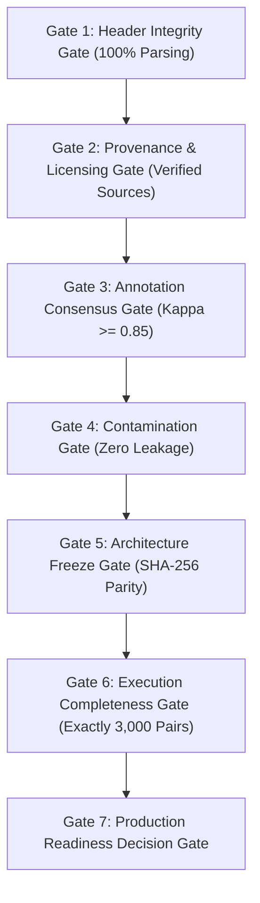

# Phase 8.0 / 8.0.1: Evaluation Acceptance Gates & Production Readiness Criteria

## 1. Executive Summary & Pre-Registration Rationale

To maintain scientific objectivity and prevent post-hoc rationalization, all evaluation criteria, acceptance gates, and production readiness thresholds are **pre-registered before benchmark execution begins**.

Following Phase 8.0.1 review, acceptance gates are strictly partitioned between **Track A (Independently Sourced Real Emails)** and **Track B (Controlled Challenge Suite)**.

---

## 2. Sequential Pre-Execution Evaluation Gates

### Gate 1: Header & Schema Integrity Gate
- **Requirement (Email Records Only — Track A & Track B1)**: All candidate email records (`is_email == true`) must possess complete, syntactically valid RFC 822 header envelopes (`From:`, `Subject:`, body) without fabricated missing transport headers.
- **Standalone Non-Email Exception (Track B2)**: Per [`phase8_1a_track_b_clarifications.md`](file:///d:/Project/IFSI-for-phishing-email-detection/results/phase8_independent_evaluation/phase8_1a_track_b_clarifications.md), standalone research papers and vulnerability advisories (`provenance_class == "standalone_non_email_document"`, `is_email == false`, `header_origin == "none"`) **must never have fabricated email headers added** and **must remain strictly outside all email classification metrics** (evaluated solely on Stage 1 / Sanitizer V2 metrics).
- **Format Integrity**: Zero null or empty body fields; proper UTF-8 character encoding; properly extracted destination URLs.
- **Gatekeeper Metric**: $100.0\%$ parsing and medium-schema validation success rate.

### Gate 2: Provenance, Ethics & Licensing Gate
- **Requirement**: Every sample must possess verifiable lineage to an authorized open-source or academic repository documented in `dataset_source_registry.md`.
- **Zero Prohibited Data**: Zero inclusion of leaked, hacked, or private personal mailbox archives (DNC, Sony, Hacking Team).
- **PII Scrubbing**: $100.0\%$ passage through automated regex PII scrubbers (zero raw credit card numbers, SSNs, personal phone numbers).

### Gate 3: Ground-Truth Quality & Annotation Gate
- **Requirement**: Ground truth labels must be established independently of IFSI model outputs.
- **Inter-Annotator Agreement**: Double annotation on a 20% random validation subset ($N = 600$) must achieve **Cohen's Kappa $\kappa \ge 0.85$** across both label dimensions (Email Phishing Status and Injection Status).
- **Action on Failure**: Annotation guidelines revision, annotator retraining, and full re-annotation of conflicting subsets.

### Gate 4: Contamination & Independence Gate
- **Requirement**: Complete isolation against all historical training, tuning, and benchmark datasets, as well as the 1,321 clean FAISS index exemplars.
- **Collision Tolerances**:
  - Exact SHA-256 Collisions: **0**
  - Normalized Text Collisions: **0**
  - MinHash 5-gram Jaccard Similarity $> 0.70$: **0**
  - Cosine Embedding Similarity vs FAISS $> 0.95$: **0** (or cleared by manual audit)
- **Gatekeeper Metric**: Automated passage of `tools/audit_phase8_dataset_independence.py`.

### Gate 5: Architecture Freeze Gate
- **Requirement**: Strict cryptographic invariance of all production, baseline, and candidate model files.
- **Verification**: Pre-execution audit confirms that `src/core/inference.py`, `src/core/inference_m4_v2.py`, `results/rag_index_clean/index.faiss`, and Phase 7 implementations match their baseline SHA-256 checksums bit-for-bit.

### Gate 6: Benchmark Execution Gate
- **Requirement**: Full paired execution across all 3,000 samples for Config A and Config B.
- **Execution Standards**:
  - Sequential execution to prevent GPU race conditions.
  - Exactly 3,000 completed predictions for Config A; exactly 3,000 completed predictions for Config B.
  - Zero dropped samples or unhandled timeout drops.
  - Checkpointing verified with zero duplicate records.

---

## 3. Gate 7: Production Readiness Decision Criteria

| Performance Metric | Scope / Denominator | Promotion Threshold | Type | Statistical & Operational Rationale |
| :--- | :--- | :--- | :---: | :--- |
| **Track A Overall Accuracy** | Track A ($N = 2,000$) | $\ge 98.5\%$ | **Hard** | Baseline fidelity on authentic emails. 95% Wilson CI: $[97.87\%, 98.96\%]$. |
| **Track A False Positive Rate** | Track A Ham ($N = 1,000$) | $\le 1.0\%$ | **Hard** | Low FP tolerance to prevent disruption. 95% Wilson CI: $[0.40\%, 1.57\%]$. |
| **Sophisticated Phishing Recall**| Track B BEC ($N = 350$) | $\ge 98.0\%$ | **Hard** | Targeted threat containment. 95% Wilson CI: $[95.96\%, 99.03\%]$. |
| **Difficult Legitimate FPR** | Track B SaaS ($N = 350$) | $\le 1.0\%$ | **Hard** | Domain Analyzer V3 false positive suppression. 95% CI: $[0.29\%, 2.49\%]$. |
| **Active Injection Containment** | Track B Active ($N = 200$)| **$= 100.0\%$** | **Hard** | Zero-tolerance security invariant. Wilson 95% CI: $[98.13\%, 100.0\%]$. |
| **Quoted Injection Safe Pass** | Track B Quoted ($N = 200$)| $\ge 95.0\%$ | **Target**| Delivery of legitimate security bulletins quoting attacks. |
| **Total Mean Latency** | All samples ($N = 3,000$) | $\le 4,500$ ms | **Target**| SLA compliance for inbound email gateway processing buffers. |
| **Total P95 Tail Latency** | All samples ($N = 3,000$) | $\le 6,000$ ms | **Hard** | Predictable execution without tail latency spikes or server timeouts. |
| **Statistical Significance** | Paired pairs ($N = 3,000$) | $p < 0.01$ (McNemar) | **Hard** | Proves false positive reduction is statistically significant vs Config A. |

> [!CAUTION]
> **Statistical Risk Caveat**: Observing 100% containment on $N = 200$ active injections does **not** prove zero underlying risk. By the Rule of Three, the true failure rate is bounded by approximately $1.50\%$ at the 95% confidence level.

---

## 4. Decision Rule Logic

At the completion of Phase 8 evaluation, the audit report will execute the following definitive decision rule:

1. **PROCEED TO PRODUCTION PROMOTION**:
   - If and only if Config B passes **ALL** hard criteria in Gate 7.
2. **REQUIRE SPECIFIC REFINEMENT**:
   - If Config B achieves $\ge 97.0\%$ accuracy and $100\%$ injection containment, but fails the FPR ($\le 1.0\%$) or P95 latency ($\le 6,000$ ms) threshold. Requires targeted domain registry or prompt refinement.
3. **ABANDON ARCHITECTURE**:
   - If Config B suffers an active injection containment failure ($< 100\%$) or sophisticated phishing recall drops below $95.0\%$.
