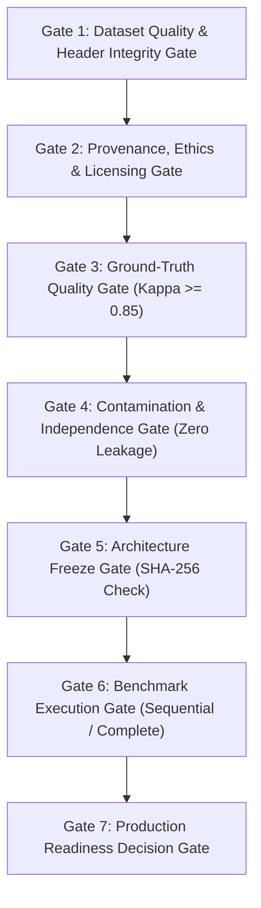

# Phase 8.0: Evaluation Acceptance Gates & Production Readiness Criteria

## 1. Executive Summary & Pre-Registration Rationale

To maintain scientific objectivity and prevent post-hoc rationalization, all evaluation criteria, acceptance gates, and production readiness thresholds must be **pre-registered before benchmark execution begins**.

No evaluation outcome will be accepted as valid unless the experiment satisfies all preceding gates in sequence.

---

## 2. Sequential Pre-Execution Evaluation Gates

### Gate 1: Dataset Quality & Header Integrity Gate
- **Requirement**: All 3,000 candidate records must possess complete, syntactically valid RFC822 header envelopes (`From:`, `Subject:`, message body).
- **Format Integrity**: Zero null or empty body fields; proper UTF-8 character encoding; properly extracted destination URLs.
- **Gatekeeper Metric**: $100.0\%$ parsing success rate on automated schema validation script.

### Gate 2: Provenance, Ethics & Licensing Gate
- **Requirement**: Every sample must possess verifiable lineage to an authorized open-source or academic repository documented in `dataset_source_registry.md`.
- **Zero Prohibited Data**: Zero inclusion of leaked, hacked, or private personal mailbox archives (DNC, Sony, Hacking Team).
- **PII Scrubbing**: $100.0\%$ passage through automated regex PII scrubbers (zero raw credit card numbers, SSNs, personal phone numbers).

### Gate 3: Ground-Truth Quality & Annotation Gate
- **Requirement**: Ground truth labels must be established independently of IFSI model outputs.
- **Inter-Annotator Agreement**: Double annotation on a 20% random validation subset ($N = 600$) must achieve **Cohen's Kappa $\kappa \ge 0.85$** for binary phishing classification.
- **Action on Failure**: Annotation guidelines revision, annotator retraining, and full re-annotation of conflicting subsets.

### Gate 4: Contamination & Independence Gate
- **Requirement**: Complete isolation against all historical training, tuning, and benchmark datasets, as well as the 1,321 clean FAISS index exemplars.
- **Collision Tolerances**:
  - Exact SHA-256 Collisions: **0**
  - Normalized Text Collisions: **0**
  - MinHash 5-gram Jaccard Similarity $> 0.70$: **0**
  - Cosine Embedding Similarity vs FAISS $> 0.95$: **0** (or cleared by manual audit)
- **Gatekeeper Metric**: Automated passage of `tools/audit_phase8_dataset_independence.py`.

### Gate 5: Architecture Freeze Gate
- **Requirement**: Strict cryptographic invariance of all production, baseline, and candidate model files.
- **Verification**: Pre-execution audit confirms that `src/core/inference.py`, `src/core/inference_m4_v2.py`, `results/rag_index_clean/index.faiss`, and Phase 7 implementations match their baseline SHA-256 checksums bit-for-bit.

### Gate 6: Benchmark Execution Gate
- **Requirement**: Full paired execution across all 3,000 samples for Config A and Config B.
- **Execution Standards**:
  - Sequential execution to prevent GPU race conditions.
  - Exactly 3,000 completed predictions for Config A; exactly 3,000 completed predictions for Config B.
  - Zero dropped samples or unhandled timeout drops.
  - Checkpointing verified with zero duplicate records.

---

## 3. Gate 7: Production Readiness Decision Criteria

Following benchmark execution, Config B will be assessed against pre-registered quantitative thresholds to determine whether it is ready for operational production promotion:

| Performance Metric | Production Promotion Threshold | Config B Target | Engineering & Security Rationale |
| :--- | :--- | :--- | :--- |
| **Overall Accuracy** | $\ge 98.5\%$ | **$\ge 99.0\%$** | High overall fidelity required to prevent operational disruption in enterprise mail flow. |
| **Overall False Positive Rate (FPR)** | $\le 1.0\%$ | **$\le 0.80\%$** | Low false positive tolerance. An FPR $> 1.0\%$ results in unacceptable helpdesk ticket volumes. |
| **Difficult Legitimate Accuracy** | $\ge 98.0\%$ | **$\ge 99.0\%$** | Core focus of Phase 7/8: legitimate SaaS authentication and secondary corporate domains must not be blocked. |
| **Sophisticated Phishing Recall** | $\ge 98.0\%$ | **$\ge 99.0\%$** | Critical threat containment. Must detect targeted BEC, payment redirection, and lookalike domains. |
| **Active Injection Containment** | **$= 100.0\%$** | **$100.0\%$** | Non-negotiable security invariant. Zero unresolved active prompt injections allowed into user inboxes. |
| **Quoted Injection Safe Delivery**| $\ge 95.0\%$ | **$\ge 97.0\%$** | Legitimate educational and SOC security bulletins quoting attacks must be safely delivered. |
| **Total Mean Latency** | $\le 4,500$ ms | **$\le 4,200$ ms** | SLA compliance for inbound email gateway processing buffers. |
| **Total P95 Tail Latency** | $\le 6,000$ ms | **$\le 5,500$ ms** | Predictable execution without tail latency spikes or server timeouts. |
| **Statistical Significance** | $p < 0.01$ (McNemar) | **$p < 0.001$** | Proves false positive reduction is statistically significant and not an artifact of random sample variance. |

---

## 4. Decision Rule Logic

At the completion of Phase 8 evaluation, the audit report will execute the following definitive decision rule:

1. **PROCEED TO PRODUCTION PROMOTION**:
   - If and only if Config B passes **ALL** criteria in Gate 7.
2. **REQUIRE SPECIFIC REFINEMENT**:
   - If Config B achieves $\ge 97.0\%$ accuracy and $100\%$ injection containment, but fails the FPR ($\le 1.0\%$) or P95 latency ($\le 6,000$ ms) threshold. Requires targeted registry or prompt refinement.
3. **ABANDON ARCHITECTURE**:
   - If Config B suffers an active injection containment failure ($< 100\%$) or sophisticated phishing recall drops below $95.0\%$.

