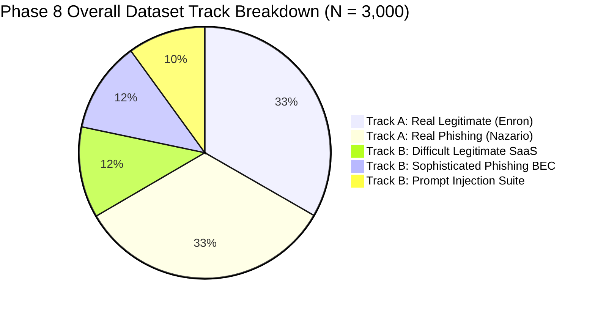

# Phase 8.0 / 8.0.1: Dataset Composition Plan & Distribution Architecture

## 1. Executive Summary & Design Target

Following the Phase 8.0.1 design correction, the IFSI Phase 8 evaluation corpus ($N = 3,000$) is divided into two distinct, independently evaluated tracks:
1. **Track A — Independently Sourced Real Email Corpus ($N = 2,000$)**: Authentic historical communications (1,000 Enron legitimate + 1,000 Nazario phishing).
2. **Track B — Controlled Adversarial Challenge Corpus ($N = 1,000$)**: Targeted enterprise challenges (350 Difficult Legitimate + 350 Sophisticated Phishing BEC + 300 Prompt Injection Payloads).



> [!IMPORTANT]
> **Strict Reporting Rule**: Track A and Track B results are reported completely separately. Track B synthetic challenge results are never blended with Track A real emails to claim real-world generalization.

---

## 2. Decoupled Two-Dimensional Label Architecture

Evaluation samples are annotated across two independent orthogonal dimensions:

### Dimension A: Email Phishing Status
- **Legitimate**: Authentic personal/business communication or legitimate corporate SaaS alerts.
- **Phishing**: Malicious intent to deceive, harvest credentials, or execute financial fraud.
- **Ambiguous / Pure Vector**: Standalone adversarial prompt injections lacking email context (evaluated exclusively on injection containment).

### Dimension B: Prompt Injection Status
- **No Injection**: Clean email content.
- **Quoted Injection**: Security bulletins, vulnerability disclosures, or phishing lures quoting attack syntax without execution intent.
- **Active Injection**: Malicious instructions attempting to override or hijack the host LLM reasoning engine.

---

## 3. Grand Cross-Tabulation Matrix ($N = 3,000$)

```
+────────────────────────────────────────────────────────────────────────────────────────────────────+
|                                  GRAND CROSS-TABULATION MATRIX (N = 3,000)                         |
+────────────────────────────────────────────────────────────────────────────────────────────────────+
|                                    │                  DIMENSION B: INJECTION STATUS                |
| DIMENSION A: PHISHING STATUS       │  No Injection     Quoted Injection    Active Injection  Total |
+────────────────────────────────────┼───────────────────────────────────────────────────────────────+
| 1. LEGITIMATE                      │                                                               |
|    - Track A (Enron Historical)    │        1,000                     0                   0  1,000 |
|    - Track B (SaaS / Vendor Auth)  │          300                    50                   0    350 |
|    - Track B (Benign + Injection)  │            0                     0                  50     50 |
|    Subtotal Legitimate             │        1,300                    50                  50  1,400 |
+────────────────────────────────────┼───────────────────────────────────────────────────────────────+
| 2. PHISHING                        │                                                               |
|    - Track A (Nazario Historical)  │        1,000                     0                   0  1,000 |
|    - Track B (BEC / Lookalikes)    │          300                    50                   0    350 |
|    - Track B (Phish + Injection)   │            0                     0                  50     50 |
|    Subtotal Phishing               │        1,300                    50                  50  1,400 |
+────────────────────────────────────┼───────────────────────────────────────────────────────────────+
| 3. AMBIGUOUS / PURE ATTACK VECTORS │                                                               |
|    - Track B (Pure LLM Overrides)  │            0                   100                  50    150 |
|    - Track B (Exemplar Exfiltration)│           0                     0                  50     50 |
|    Subtotal Ambiguous              │            0                   100                 100    200 |
+────────────────────────────────────┼───────────────────────────────────────────────────────────────+
| GRAND TOTAL                        │        2,600                   200                 200  3,000 |
+────────────────────────────────────────────────────────────────────────────────────────────────────+
```

---

## 4. Track Specifications

### 4.1 Track A: Real Email Corpus ($N = 2,000$)
- **Legitimate ($N = 1,000$)**: Sourced from the CMU Enron Email Archive.
  - Peer-to-peer operational emails ($N = 400$)
  - Scheduling, meeting invitations, status updates ($N = 300$)
  - External business & vendor inquiries ($N = 300$)
- **Phishing ($N = 1,000$)**: Sourced from the Jose Nazario Phishing Corpus.
  - Financial & banking credential harvesters ($N = 400$)
  - Webmail / cloud login lures ($N = 350$)
  - E-commerce, invoice, & delivery lures ($N = 250$)
- **Injection Count**: Exactly 0.

### 4.2 Track B: Controlled Challenge Suite ($N = 1,000$)
- **Difficult Legitimate ($N = 350$)**:
  - Multi-tenant enterprise SaaS (Okta, Workday, Microsoft 365) ($N = 150$)
  - Corporate secondary domains (AWS Console, Amazon Business, Concur) ($N = 100$)
  - Urgent internal IT & security maintenance bulletins ($N = 100$)
- **Sophisticated Phishing ($N = 350$)**:
  - Executive BEC / zero-link financial redirection ($N = 150$)
  - Synthetic lookalike brand domains ($N = 120$)
  - Display name spoofing & reply-to hijacking ($N = 80$)
- **Prompt Injection Suite ($N = 300$)**:
  - Active Malicious Instructions ($N = 150$): Direct override, XML escapes, markdown exfiltration, CJK multilingual.
  - Quoted Benign Security Advisories ($N = 150$): Threat reports, employee awareness bulletins.


---

## 5. Industry and Formatting Representation

The dataset plan requires minimum representation thresholds across corporate sectors:

| Industry Sector | Target Allocation | Representative Enterprise Context |
| :--- | :--- | :--- |
| **Technology & Software** | 30.0% ($N = 900$) | Cloud infrastructure, developer tooling, Git PR notices, SaaS tenant authentication. |
| **Financial Services & Banking** | 25.0% ($N = 750$) | Wire transfers, SEC compliance, regulatory filings, audit confirmations, invoice approvals. |
| **Healthcare & Pharmaceuticals** | 15.0% ($N = 450$) | HIPAA notices, patient records portals, medical device vendor communications. |
| **Higher Education & Research** | 15.0% ($N = 450$) | Grant proposals, university payroll, faculty notices, departmental funding. |
| **Manufacturing & Logistics** | 15.0% ($N = 450$) | Supply chain logistics, purchase orders, shipping manifests, warehouse dispatch. |

### Email Formatting Diversity
- Plain Text (RFC822): 40% ($N = 1,200$)
- Multipart MIME (Text + HTML representation): 50% ($N = 1,500$)
- Rich Formatting / Tables / Structured Links: 10% ($N = 300$)
