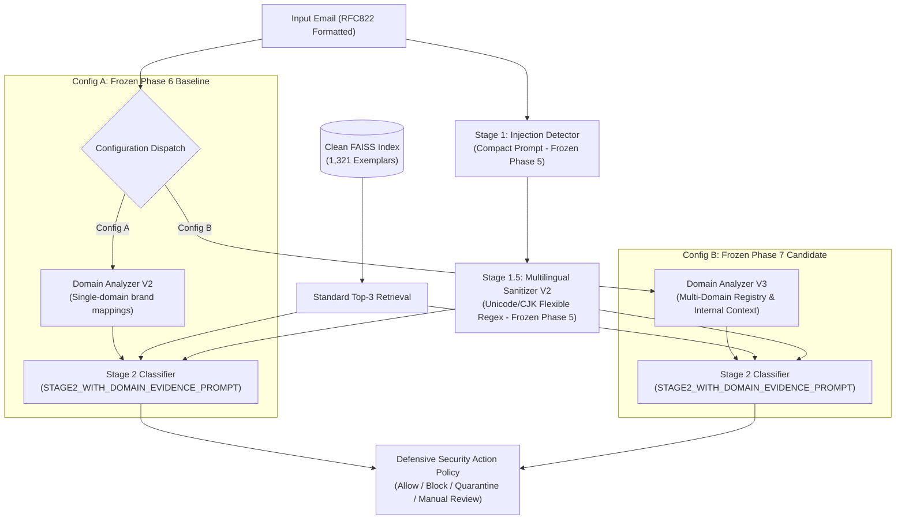

# Phase 8.0: Large-Scale Independent Evaluation Protocol

## 1. Executive Summary & Objective

This document defines the formal, scientifically defensible evaluation protocol for the large-scale independent validation of the **IFSI Phishing Email Detection Pipeline**. 

Phase 7 established that **Config B (Domain Analyzer V3)** successfully eliminated historical false positives on legitimate enterprise secondary and SaaS domains, achieving a **0.77% False Positive Rate (FPR)** and **100.0% Sophisticated Phishing Recall** across a controlled 240-email benchmark. 

The objective of Phase 8 is to evaluate whether these performance characteristics generalize to a scaled, independently sourced corpus of **3,000 emails** without model retraining, threshold tuning, or architectural modifications.

> [!IMPORTANT]
> **Phase 8.0 Execution Boundary**: This phase is strictly dedicated to research design, provenance planning, and evaluation infrastructure preparation. **No large-scale benchmark inference is executed during Phase 8.0**, and no external datasets are ingested prior to passing the pre-registered acceptance gates.

---

## 2. Experimental Candidate & Baseline Configurations

Phase 8 evaluates a strictly controlled, paired comparison between two frozen configurations on identical email inputs:

### Configuration Specifications

| Parameter | Config A (Frozen Phase 6 Baseline) | Config B (Frozen Phase 7 Candidate) | Invariance Requirement |
| :--- | :--- | :--- | :--- |
| **Model Engine** | `qwen3.5:4b` via local Ollama instance | `qwen3.5:4b` via local Ollama instance | **Identical** model binary & weights |
| **Generation Parameters** | `temperature: 0.0`, `num_predict: 512`, `top_p: 1.0` | `temperature: 0.0`, `num_predict: 512`, `top_p: 1.0` | **Identical** greedy decoding settings |
| **Stage 1 (Injection)** | Compact Prompt (`STAGE1_COMPACT_PROMPT`) | Compact Prompt (`STAGE1_COMPACT_PROMPT`) | **Identical** system prompt & schema |
| **Stage 1.5 (Sanitizer)** | Multilingual Sanitizer V2 (`sanitizer_v2.py`) | Multilingual Sanitizer V2 (`sanitizer_v2.py`) | **Identical** regex & span extraction |
| **RAG Retrieval** | Standard Top-3 from Clean FAISS Index (1,321 vectors) | Standard Top-3 from Clean FAISS Index (1,321 vectors) | **Identical** embedding model & index |
| **Domain Telemetry** | **Domain Analyzer V2** (`domain_analyzer_v2.py`) | **Domain Analyzer V3** (`domain_analyzer_v3.py`) | **Experimental Independent Variable** |
| **Stage 2 (Classifier)** | `STAGE2_WITH_DOMAIN_EVIDENCE_PROMPT` | `STAGE2_WITH_DOMAIN_EVIDENCE_PROMPT` | **Identical** system prompt |
| **Operational Policy** | Quarantine/Block on active injection, Fail-safe error routing | Quarantine/Block on active injection, Fail-safe error routing | **Identical** security action logic |

---

## 3. Execution Environment & Repeatability Controls

1. **Hardware & Operating Environment**:
   - Host OS: Windows (PowerShell execution environment).
   - Execution Device: Local dedicated GPU acceleration via Ollama service (`127.0.0.1:11434`).
   - Python Runtime: Python 3.13.9.
2. **Deterministic Inference Controls**:
   - Greedy decoding (`temperature: 0.0`) enforced across all API calls.
   - Sequential execution across all configurations to avoid concurrent GPU memory contention and thread interleaving.
   - Batch-isolated Ollama process warmup: 1 dummy inference executed prior to benchmark commencement to ensure model weights and KV cache are initialized.
3. **Resilience & Checkpointing Protocol**:
   - Immediate per-sample disk flushing: every record written to `predictions.jsonl` immediately upon inference completion.
   - Safe resume capability: tracking unique `(config_id, sample_id)` keys to prevent redundant execution or duplicate records upon session resumption.
   - Timeout Handling: 60.0-second HTTP socket timeout; requests exceeding this limit default to `security_action: manual_review` and `verdict: error`.

---

## 4. Methodological Safeguards Against Bias

1. **Strict Double-Blind Input Feeding**:
   Both configurations receive bit-for-bit identical candidate email strings (`From: ...\nSubject: ...\n\n...`).
2. **Retriever Invariance**:
   Under no circumstances will any sample from the Phase 8 evaluation corpus be added to the FAISS index. The index remains strictly frozen at 1,321 vectors.
3. **No Dynamic Registry Inflation**:
   `VERIFIED_ENTERPRISE_RELATIONSHIPS` in `domain_analyzer_v3.py` remains frozen during evaluation. No domain may be added to the registry post-hoc to resolve benchmark false positives.

