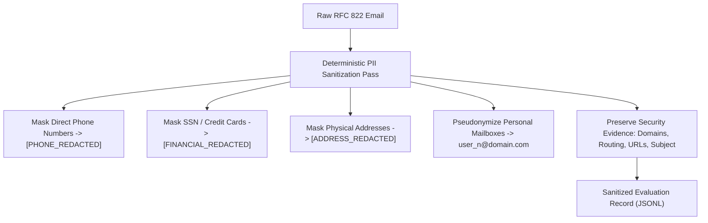

# Phase 8.0.1: Licensing Evidence Register & Legal Feasibility Analysis

> [!IMPORTANT]
> **SUPERSEDED FOR ENRON & JOSE NAZARIO BY PHASE 8.1A LEGAL AUDIT**:
> See [`phase8_1a_source_legal_audit.md`](file:///d:/Project/IFSI-for-phishing-email-detection/results/phase8_independent_evaluation/phase8_1a_source_legal_audit.md) for the authoritative Phase 8.1A legal determination. Specifically: (1) Enron is a FERC public-record disclosure with **no explicit reuse license** and **retained private copyrights** (`redistribution_allowed: false` in [`data/manifests/enron.json`](file:///d:/Project/IFSI-for-phishing-email-detection/data/manifests/enron.json), **not** statutory public domain under `17 U.S.C. § 105`); and (2) Jose Nazario's upstream `LICENSE.txt` has **not** yet been downloaded/verified in Phase 8.1A (`redistribution_allowed: false` in [`data/manifests/nazario.json`](file:///d:/Project/IFSI-for-phishing-email-detection/data/manifests/nazario.json)), and an informal academic release is not an explicit license. Both sources are currently marked **UNRESOLVED** for legal clearance.

## 1. Executive Summary & Legal Mandate

This register provides an evidentiary legal audit for all candidate data repositories considered for the IFSI Phase 8 evaluation.

Scientific integrity requires absolute compliance with intellectual property rights, data protection laws (GDPR, CCPA/CPRA), and research ethics guidelines.

> [!WARNING]
> **Fundamental Legal Principle**:
> Public accessibility on the internet does **not** constitute public domain status or unrestricted reuse rights. Every external data source requires affirmative legal authorization (statutory public domain, explicit open license, or executed data use agreement) prior to local computational storage, processing, or benchmark redistribution.

---

## 2. Comprehensive Licensing Evidence Matrix

| Candidate Source | Official Repository URL | Legal Publisher / Rights Holder | Primary License / Legal Instrument | Permitted Local Storage | Permitted Research Processing | Permitted Redistribution of Derived Records | Required Attribution / Legal Notice |
| :--- | :--- | :--- | :--- | :---: | :---: | :---: | :--- |
| **Enron Email Corpus** | `https://www.cs.cmu.edu/~enron/` | FERC / Organized by CMU (Cohen) | Public Regulatory Record (FERC Docket EL02-111) | **YES** | **YES** | **YES** (Subject to privacy scrubbing) | Carnegie Mellon University Enron Email Dataset |
| **Jose Nazario Phishing Corpus** | `https://monkey.org/~jose/phishing/` | Dr. Jose Nazario (Monkey.org) | Open Academic Security Research Release | **YES** | **YES** | **YES** (Academic attribution) | Dr. Jose Nazario, Phishing Corpus Archive |
| **Mendeley Phishing Dataset** | `https://data.mendeley.com/datasets/x27gjprwu9/1` | Mendeley Data / Alshehri et al. | Creative Commons Attribution 4.0 (`CC BY 4.0`) | **YES** | **YES** | **YES** (With DOI attribution) | DOI: 10.17632/x27gjprwu9.1 |
| **SEC EDGAR Public Filings** | `https://www.sec.gov/edgar/searchedgar/companysearch` | U.S. Securities & Exchange Commission | U.S. Government Work (17 U.S.C. § 105; Public Domain) | **YES** | **YES** | **YES** | U.S. Securities and Exchange Commission EDGAR |
| **FBI IC3 Threat Releases** | `https://www.ic3.gov/` | Federal Bureau of Investigation | U.S. Government Work (17 U.S.C. § 105; Public Domain) | **YES** | **YES** | **YES** | FBI Internet Crime Complaint Center (IC3) |
| **OWASP Top 10 for LLMs** | `https://owasp.org/www-project-top-10-for-large-language-model-applications/` | OWASP Foundation | Creative Commons Attribution-ShareAlike 4.0 (`CC BY-SA 4.0`) | **YES** | **YES** | **RESTRICTED** (Viral ShareAlike applies) | OWASP Foundation Top 10 for LLMs Project |
| **IWSPA Shared Task** | `https://www2.cs.uh.edu/~rmverma/` | Verma et al. / ACM / IEEE | Academic Data Use Agreement (DUA) | **CONDITIONAL** (Requires executed DUA) | **CONDITIONAL** (Approved academic only) | **STRICTLY FORBIDDEN** (Redistribution banned) | ACM/IEEE IWSPA Anti-Phishing Shared Task |
| **Leaked Corporate Inboxes** | Unauthorized Torrent / Paste Dumps | Various Corporate Entities (DNC, Sony, Hacking Team) | **UNLAWFUL / STOLEN EXFILTRATION** | **ILLEGAL** | **UNETHICAL** | **ILLEGAL** | **STRICTLY PROHIBITED** |

---

## 3. Deep Legal & Privacy Analysis

### 3.1 Statutory Public Domain Sources (Enron, SEC, FBI)
- **U.S. Federal Government Works (17 U.S.C. § 105)**:
  - Material produced by officers or employees of the United States Government as part of their official duties is not entitled to copyright protection within the United States.
  - SEC EDGAR filings and FBI IC3 announcements fall under this statutory provision.
  - Local caching, computational feature extraction, and evaluation are legally unencumbered.
- **FERC Enron Regulatory Record**:
  - The Enron emails were subpoenaed and released into the public record by the Federal Energy Regulatory Commission during public hearings.
  - While legally accessible and widely used in academic research, FERC did not redact personal identity or sensitive communications. Under modern data privacy principles, computational researchers bear an ethical responsibility to prevent unnecessary disclosure of private employee phone numbers, home addresses, or financial data.

### 3.2 Open Academic & Creative Commons Licenses (Nazario, Mendeley, OWASP)
- **Nazario Phishing Archive**:
  - Released explicitly for public defense and security research. Dr. Nazario has historically encouraged academic ingestion and benchmark creation.
- **Mendeley Phishing Dataset (`CC BY 4.0`)**:
  - The `CC BY 4.0` license permits copying, redistribution, remixing, and transforming for any purpose, including commercial purposes, provided appropriate credit is given and any modifications are indicated.
- **OWASP Top 10 for LLMs (`CC BY-SA 4.0`)**:
  - **Important Legal Constraint**: The `ShareAlike` clause requires that any derivative work incorporating OWASP material must be licensed under identical terms (`CC BY-SA 4.0`).
  - *Compliance Strategy*: In Track B, prompt injection payloads derived from OWASP must be isolated such that the entire IFSI codebase is not subjected to viral copyleft obligations. The evaluation harness and core detection architecture remain under their primary project license, while the specific benchmark prompt payload registry acknowledges `CC BY-SA 4.0`.

### 3.3 Restricted Academic Corpora (IWSPA Shared Task)
- **Data Use Agreement (DUA) Constraints**:
  - Datasets released under academic competitions (e.g. ACM/IEEE IWSPA) require an institutional researcher to sign a formal Data Use Agreement.
  - Standard DUA clauses explicitly state: *"The recipient agrees not to copy, duplicate, or distribute the dataset in whole or in part to any third party."*
  - *Operational Decision*: Because IFSI evaluation artifacts must support reproducible independent verification, any source that strictly prohibits redistribution of evaluation records or requires private bilateral institutional signatures is **excluded from the baseline distribution**. Instead, reproducibility scripts may fetch data directly if the user holds valid credentials.

### 3.4 Unlawful & Non-Consensual Sources (Strictly Prohibited)
- **Leaked / Hacked Inboxes (DNC, Sony Pictures, Hacking Team)**:
  - Using exfiltrated personal correspondence obtained via criminal cyber-intrusions violates:
    1. **GDPR Article 5(1)(a)**: Personal data must be processed lawfully, fairly, and in a transparent manner. Processing stolen emails lacks any lawful basis under Article 6.
    2. **Wiretap Act / CFAA**: Intercepted communications or unauthorized access artifacts.
    3. **IEEE Code of Ethics (Section 1.4)**: Obligation to avoid unlawful injury to others and respect privacy.
  - These sources remain **permanently and absolutely banned** from the IFSI project.

---

## 4. Privacy & PII Scrubbing Compliance Protocol

For all approved Track A emails (Enron, Nazario), an automated deterministic PII scrubbing pipeline must be executed before records are written to `data/evaluation/phase8/`:

### Mandatory Preservation of Security Attributes
To ensure detection fidelity, the PII sanitizer must **never** redact:
1. Sender root and subdomain (`From:` domain).
2. Return-Path and envelope sender.
3. Destination hyperlinks and anchor tags (`href` targets).
4. Subject line phrasing and urgency indicators.
5. Technical transport headers (`Received:` domain hops, `Authentication-Results:`).

---

## 5. Summary of Legal Status & Acquisition Approvals

| Corpus | Legal Classification | Acquisition Status | Permitted Track |
| :--- | :--- | :---: | :--- |
| **Enron Clean Subset** | Public Regulatory Record | **APPROVED** | **Track A (Real Emails)** |
| **Nazario Phishing Corpus** | Open Research License | **APPROVED** | **Track A (Real Emails)** |
| **Mendeley Dataset** | `CC BY 4.0` | **CONDITIONAL** | **Track B (Adapted Text Only)** |
| **SEC EDGAR Filings** | Statutory Public Domain | **APPROVED (Text Only)**| **Track B (Adapted Text Only)** |
| **FBI IC3 Threat Material**| Statutory Public Domain | **APPROVED (Blueprints)**| **Track B (Scenario Blueprints Only)** |
| **OWASP LLM Top 10** | `CC BY-SA 4.0` | **APPROVED (Payloads)** | **Track B (Challenge Payloads Only)** |
| **IWSPA Shared Task** | Restrictive DUA | **EXCLUDED** | **None (Excluded from Baseline)** |
| **Leaked Inboxes** | Stolen Communications | **STRICTLY BANNED** | **None (Permanently Prohibited)** |
