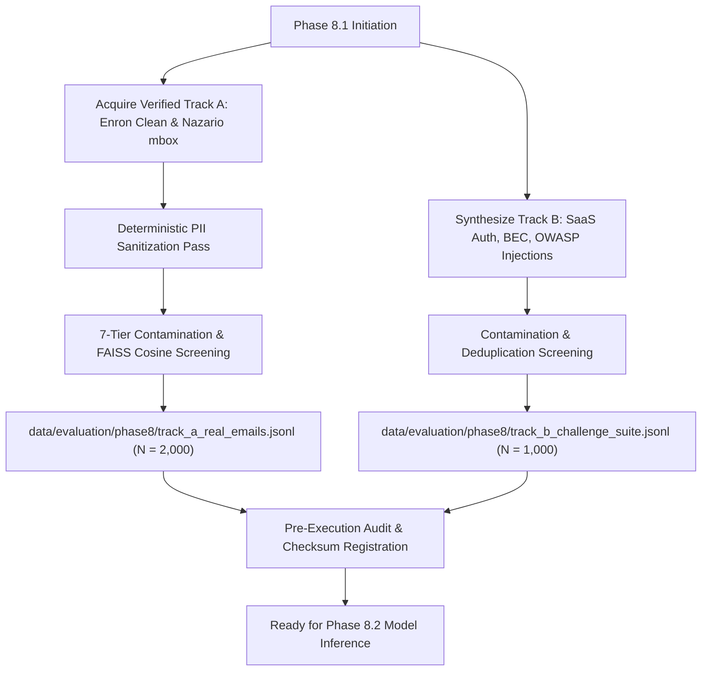

# Phase 8.0.1: Acquisition Readiness Decision & Phase 8.1 Authorization

> [!CAUTION]
> **SUPERSEDED BY PHASE 8.1A PREFLIGHT & INDEPENDENCE AUDIT**:
> Following the Phase 8.1A research-governance and historical data-independence audit ([`phase8_1a_final_decision.md`](file:///d:/Project/IFSI-for-phishing-email-detection/results/phase8_independent_evaluation/phase8_1a_final_decision.md), [`phase8_1a_source_legal_audit.md`](file:///d:/Project/IFSI-for-phishing-email-detection/results/phase8_independent_evaluation/phase8_1a_source_legal_audit.md), [`phase8_1a_enron_independence_audit.md`](file:///d:/Project/IFSI-for-phishing-email-detection/results/phase8_independent_evaluation/phase8_1a_enron_independence_audit.md), and [`phase8_1a_nazario_independence_audit.md`](file:///d:/Project/IFSI-for-phishing-email-detection/results/phase8_independent_evaluation/phase8_1a_nazario_independence_audit.md)), the preliminary approval below is **PLACED ON HOLD (`Neither source cleared for acquisition.`)** until unresolved licensing, non-redistribution governance, and historical data-independence prerequisites are satisfied.

## 1. Executive Summary & Formal Decision (Historical Phase 8.0.1 Draft)

This document establishes the formal readiness determination for transitioning from evaluation design (Phase 8.0 / 8.0.1) to dataset acquisition (Phase 8.1).

### Formal Determination:
> **APPROVED FOR LIMITED ACQUISITION; SPECIFIC SOURCES REMAIN EXCLUDED.**

---

## 2. Decision Rationale & Source Clearance Status

The comprehensive audit in Phase 8.0.1 resolved critical ambiguities in provenance, licensing, content medium, and class balance. Sourcing authorization is divided into approved, conditional, and permanently excluded tiers:

```
┌─────────────────────────────────────────────────────────────────────────────────────────────────┐
|                                    SOURCE ACQUISITION DIRECTORY                                 |
├─────────────────────────────────────────────────────────────────────────────────────────────────┤
|                                                                                                 |
|  1. APPROVED FOR RAW EMAIL ACQUISITION (TRACK A: REAL EMAIL CORPUS)                             |
|  ──────────────────────────────────────────────────────────────────                             |
|  ✓ Enron Email Corpus (Curated Clean Subset)                                                    |
|    - Publisher: FERC / CMU (Cohen). License: Public Regulatory Record.                          |
|    - Target Quota: 1,000 Ordinary Legitimate RFC 822 emails.                                    |
|    - Condition: Mandatory automated PII redaction pass prior to storage.                        |
|                                                                                                 |
|  ✓ Jose Nazario Phishing Corpus                                                                 |
|    - Publisher: Dr. Jose Nazario. License: Academic Security Research.                          |
|    - Target Quota: 1,000 Conventional Phishing RFC 822 emails.                                  |
|    - Condition: Domain extraction validation; deduplication against clean FAISS index.          |
|                                                                                                 |
|  2. APPROVED FOR CHALLENGE SUITE BLUEPRINTS & PAYLOADS (TRACK B)                                |
|  ──────────────────────────────────────────────────────────────────                             |
|  ✓ OWASP Top 10 for LLMs Benchmark Payloads                                                    |
|    - Publisher: OWASP Foundation. License: CC BY-SA 4.0.                                        |
|    - Usage: Prompt injection string library (150 active malicious, 150 quoted benign).          |
|    - Condition: Must be embedded into synthetic email envelopes; attribution retained.         |
|                                                                                                 |
|  ✓ Synthetic BEC & Enterprise SaaS Challenge Suite                                              |
|    - Usage: 350 Difficult Legitimate SaaS notices + 350 Sophisticated Phishing BEC.             |
|    - Blueprint Source: FBI IC3 scenario narratives & SEC public disclosures (text structure).   |
|                                                                                                 |
|  3. EXCLUDED FROM RAW EMAIL ACQUISITION (TRACK A)                                               |
|  ─────────────────────────────────────────────────                                              |
|  ✗ SEC EDGAR Filings: Excluded from Track A. Content consists of corporate 10-K/8-K regulatory  |
|    filings, NOT RFC 822 email messages.                                                         |
|  ✗ FBI IC3 Threat Material: Excluded from Track A. Content consists of narrative crime alerts   |
|    and loss summaries, NOT raw email files.                                                     |
|  ✗ Mendeley Phishing CSV: Excluded from Track A. Pre-parsed CSV format strips raw transport     |
|    headers (`Received:`, `Authentication-Results:`), invalidating header evidence analysis.     |
|                                                                                                 |
|  4. STRICTLY PROHIBITED (PERMANENTLY EXCLUDED)                                                  |
|  ─────────────────────────────────────────────                                                  |
|  ✗ Leaked / Stolen Mailbox Dumps (DNC, Sony Pictures, Hacking Team): Non-consensual exfiltration|
|    violating GDPR Article 5(1)(a) and IEEE ethical guidelines.                                  |
|                                                                                                 |
└─────────────────────────────────────────────────────────────────────────────────────────────────┘
```

---

## 3. Scope Boundaries & Frozen Architectures

Prior to commencing any Phase 8.1 acquisition scripts, the following components remain frozen and protected:
1. **Production M4 Baseline**: `src/core/inference.py`
2. **Frozen A1 Candidate**: `src/core/inference_m4_v2.py`
3. **Clean FAISS RAG Index**: `results/rag_index_clean/index.faiss` (1,321 vectors)
4. **Phase 7 Candidate Implementations**: `src/experiments/phase7_domain_precision/` (`domain_analyzer_v3.py`, `engine_v4.py`)
5. **Historical Benchmarks**: Phase 4, Phase 5, Phase 6, Phase 7 prediction records and datasets.

---

## 4. Operational Requirements for Phase 8.1 Acquisition

When dataset acquisition commences in Phase 8.1, the ingestion pipeline must adhere to these operational mandates:

### Mandate 1: Dual-Track Storage Segregation
- Track A data must be written to: `data/evaluation/phase8/track_a_real_emails.jsonl`
- Track B data must be written to: `data/evaluation/phase8/track_b_challenge_suite.jsonl`
- A strict schema validation script must guarantee zero record mixing between tracks.

### Mandate 2: Automated 7-Tier Leakage Screening
Every downloaded sample must be checked by `tools/audit_phase8_dataset_independence.py` against:
- All historical evaluation sets (Phase 4, 5, 6, 7).
- All 1,321 vectors in the clean FAISS index.
- Reject any sample with normalized text collision or Jaccard similarity $\ge 0.70$.

### Mandate 3: Automated PII Masking
All Track A emails must pass deterministic regex masking replacing direct telephone numbers, home postal addresses, and credit card numbers with standardized tokens (`[PHONE_REDACTED]`, `[FINANCIAL_REDACTED]`), while strictly preserving security domain tokens and hyperlinks.

---

## 5. Phase 8.1 Acquisition Roadmap



---

## 6. Sign-Off & Recommendation

Phase 8.0.1 design corrections are complete.

**Recommendation**: Proceed to **Phase 8.1: Controlled Acquisition & Ingestion of Approved Sources**.
