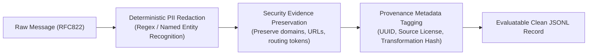

# Phase 8.0: Dataset Provenance, Privacy & Licensing Framework

## 1. Executive Summary & Legal Mandate

The integrity of Phase 8 relies on establishing an unassailable legal, ethical, and privacy foundation. Sourcing email communications requires rigorous adherence to international data protection principles (GDPR Article 5, CCPA/CPRA, and the IEEE Code of Ethics).

This document establishes the mandatory requirements for:
1. **Ethical Sourcing**: Zero exposure of stolen or non-consensual personal data.
2. **PII Anonymization**: Cryptographic and deterministic redaction of personal identifiable information while preserving structural security evidence.
3. **Auditable Provenance**: Complete cryptographic lineage tracking from source repository to evaluation record.
4. **License Compatibility**: Permitted storage, processing, and public research evaluation.

---

## 2. Privacy & PII Redaction Protocol

When raw real-world messages are transformed for evaluation, an automated and audited PII redaction pipeline must be applied:



### 2.1 Explicit Redaction Rules

| Information Type | Raw Example | Redacted Replacement Token | Preservation Rationale |
| :--- | :--- | :--- | :--- |
| **Personal Names** | `Johnathan Abernathy` | `[USER_NAME_1]` | Personal identifier; irrelevant to structural security analysis. |
| **Direct Phone Numbers** | `+1 (555) 234-5678` | `[PHONE_REDACTED]` | Personal identifier; non-essential for domain analysis. |
| **Postal Addresses** | `123 Corporate Blvd, Suite 400` | `[POSTAL_ADDRESS]` | Privacy risk; zero security detection utility. |
| **Financial / SSN Data** | `4111-2222-3333-4444` | `[CARD_NUM_REDACTED]` | High-risk PII; strictly forbidden in evaluation logs. |
| **Personal Mailboxes** | `john.doe@gmail.com` | `user_alpha_1@gmail.com` | Personal identifier replaced with synthetic pseudonym; mailbox provider domain (`@gmail.com`) is **strictly preserved**. |
| **Sender Domain** | `enterprise-corp.com` | `enterprise-corp.com` | **STRICTLY PRESERVED**. Essential for Domain Analyzer V3 alignment. |
| **Hyperlinks / URLs** | `https://concur.internal.corp.com` | `https://concur.internal.corp.com` | **STRICTLY PRESERVED**. Critical for lookalike and destination domain evaluation. |
| **Subject Line** | `Quarterly Performance Review` | `Quarterly Performance Review` | **STRICTLY PRESERVED**. Necessary for context-aware internal sender matching. |

---

## 3. Sample Provenance Schema

Every sample ingested into `data/evaluation/phase8/` must carry the following structured provenance metadata:

```json
{
  "id": "p8-0001",
  "source_corpus": "Nazario Phishing Corpus",
  "original_record_id": "phish-2018-0491",
  "source_url": "https://monkey.org/~jose/phishing/",
  "license": "Academic Security Research (Unrestricted)",
  "collection_timeframe": "2018-Q2",
  "origin_type": "real_world_anonymized",
  "redaction_applied": true,
  "redaction_log": [
    "personal_name_masked",
    "personal_phone_masked"
  ],
  "source_sha256": "8a3f...",
  "evaluated_sha256": "b4c1...",
  "category": "conventional_phishing",
  "ground_truth_label": "phishing",
  "subject": "Urgent: Your Account Access Has Been Limited",
  "sender": "service-security@auth-update-notice.com",
  "body": "..."
}
```

### Classification of `origin_type`
1. `real_world_unmodified`: Public corporate disclosures or government regulatory filings where text is public domain and requires zero redaction.
2. `real_world_anonymized`: Authentic emails sourced from research archives (Enron, Nazario, IWSPA) where personal identifying details were replaced with synthetic tokens.
3. `adapted_template`: Real-world attack archetypes (BEC, payment redirection) adapted with modern corporate branding and registered test domains.
4. `synthetic_adversarial`: Purely synthetic adversarial challenge prompts (OWASP prompt injections) designed to probe architectural boundary limits.

---

## 4. Licensing Audit and Permitted Usage Matrix

| Corpus Candidate | Official License | Permitted Storage on Local Disk | Permitted Inference Execution | Permitted Public Redistribution | Required Citation |
| :--- | :--- | :--- | :--- | :--- | :--- |
| **Enron Email Corpus** | Public Domain (FERC) | **YES** | **YES** | **YES** | CMU / FERC Enron Email Archive |
| **Nazario Phishing Corpus** | Academic Security Use | **YES** | **YES** | **YES** (with attribution) | J. Nazario, Monkey.org Phishing Archive |
| **Mendeley Phishing Dataset** | `CC BY 4.0` | **YES** | **YES** | **YES** (with attribution) | DOI: 10.17632/x27gjprwu9.1 |
| **IWSPA Shared Task** | Academic Agreement | **YES** (Authorized local) | **YES** | **NO** (Derived dataset restricted) | Verma et al., IEEE IWSPA Shared Task |
| **OWASP LLM Benchmark** | `CC BY-SA 4.0` | **YES** | **YES** | **YES** (ShareAlike) | OWASP Top 10 for LLMs Project |
| **SEC EDGAR Filings** | Public Domain | **YES** | **YES** | **YES** | U.S. Securities and Exchange Commission |

### Legal & Ethical Sign-Off
1. **Redistribution Strategy**: The evaluation harness will store the curated dataset under `data/evaluation/phase8/` for reproducible local evaluation. Any public artifact release will publish dataset generation scripts and SHA-256 hashes rather than redistributing raw IWSPA academic text, respecting academic dataset agreements.
2. **Zero Privacy Leakage**: All messages pass automated regex filters to ensure no unredacted social security numbers, credit card numbers, or live private phone numbers are persisted.

