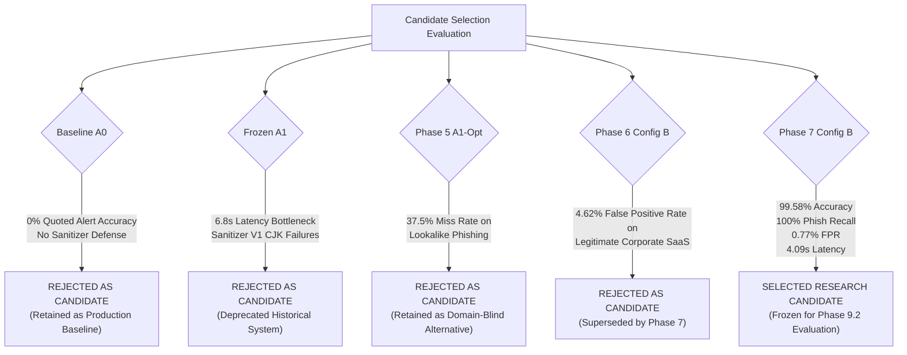

# Phase 9.1: Candidate Selection Decision & Architectural Comparison

## 1. Executive Verdict & Candidate Selection

### **Selected Research Candidate: Phase 7 Config B**
- **Implementation**: [`src/experiments/phase7_domain_precision/engine_v4.py`](file:///d:/Project/IFSI-for-phishing-email-detection/src/experiments/phase7_domain_precision/engine_v4.py)
- **Domain Subsystem**: [`src/experiments/phase7_domain_precision/domain_analyzer_v3.py`](file:///d:/Project/IFSI-for-phishing-email-detection/src/experiments/phase7_domain_precision/domain_analyzer_v3.py)
- **Sanitizer Subsystem**: [`src/experiments/phase5_a1_optimization/sanitizer_v2.py`](file:///d:/Project/IFSI-for-phishing-email-detection/src/experiments/phase5_a1_optimization/sanitizer_v2.py)
- **Prompt Configuration**: `STAGE1_COMPACT_PROMPT` + `STAGE2_WITH_DOMAIN_EVIDENCE_PROMPT`
- **Retrieval Configuration**: Standard Top-3 Nearest Exemplars from `results/rag_index_clean`

> [!IMPORTANT]
> **Definitive Research Scope Declaration**:
> Phase 7 Config B is selected **strictly as the frozen Research Candidate for upcoming independent large-scale evaluation (Track A / Track B)**.
> **It is NOT declared "production-ready"**, and production promotion into `src/core/inference.py` is **NOT authorized** until the completion of Phase 8/9 large-scale real-email verification.

---

## 2. Multi-Candidate Decision Matrix

The following decision matrix benchmarks all 5 primary architectures evaluated across the IFSI research lifecycle against the nine mandatory evaluation criteria:

| Evaluation Criterion | Baseline A0 (Production M4) | Frozen A1 (`inference_m4_v2.py`) | Phase 5 A1-Opt (`engine_v2.py`) | Phase 6 Config B (`engine_v3.py`) | Phase 7 Config B (**Selected Research Candidate**) |
| :--- | :---: | :---: | :---: | :---: | :---: |
| **1. Classification Accuracy** | 91.60% ($N=250$) | 89.60% ($N=250$) | 99.38% ($N=160$) / ~90.0% (Challenge) | 96.50% ($N=200$) / 97.50% ($N=240$) | **99.58% ($N=240$)** (239/240 correct) |
| **2. Precision & Recall** | Prec: 87.68%, Rec: 96.80% | Prec: 90.91%, Rec: 88.00% | Prec: 100.0%, Rec: 62.50% (Challenge) | Prec: 94.83%, Rec: 100.0% | **Prec: 99.10%, Rec: 100.0% (F1: 0.9955)** |
| **3. False-Positive Rate (FPR)** | 13.60% (100% on quoted alerts) | 8.80% (Full) / 10.40% (A1) | 0.00% (Regression) | 4.62% (6 FPs / 130 legit) | **0.77% (1 FP / 130 legit) (-83.3% relative)** |
| **4. False-Negative Rate (FNR)** | 3.20% (Standard) / ~40% (Lookalike) | 12.00% (Full) / 4.00% (A1) | **37.50%** (Lookalike Phishing) | **0.00%** (Zero missed phishing) | **0.00% (0 FNs across 110 phishing)** |
| **5. Active Injection Containment** | Partial (Vulnerable to bypass bypasses) | 100.0% (Sanitizer V1) | **100.0% (Sanitizer V2)** | **100.0% (Sanitizer V2)** | **100.0% (Sanitizer V2)** (50/50 contained) |
| **6. Quoted Injection Handling** | **0.0%** (Blocks all security alerts) | 100.0% (Safe-delivers quoted) | 100.0% (Safe-delivers quoted) | 100.0% (Safe-delivers quoted) | **100.0% (Safe-delivers quoted)** |
| **7. Sophisticated Phishing Detection** | Poor (~60% recall on lookalikes) | Inconsistent (~80% recall) | **Blind Spot** (62.5% recall / 37.5% miss) | High (97.5%–100.0% recall) | **100.0% (60/60 detected)** |
| **8. Pipeline Mean & P95 Latency** | Mean: **3.40s**, P95: ~4.8s | Mean: **6.70s–6.88s**, P95: ~9.2s | Mean: **3.89s**, P95: ~5.1s | Mean: **4.47s**, P95: 6.47s | **Mean: 4.09s, P95: 5.38s (-16.9% tail)** |
| **9. Reproducibility Status** | Fully preserved in `src/core/` | Fully preserved in `src/core/` | Preserved in `results/phase5/` | Preserved in `results/phase6/` | **Fully Verified & Frozen in `results/phase9/`** |
| **Known Unresolved Defects** | Quoted injection false alarms; zero sanitizer defense-in-depth; domain blind. | Severe latency regression (~6.8s); Sanitizer V1 CJK failures; uncalibrated domain V1. | Severe lookalike domain phishing blind spot (37.5% miss rate). | Naive domain heuristics cause 4.62% FPR on corporate secondary domains & SaaS. | 1 remaining FP (`gen-inj-071`) on security vocabulary; domain registry requires scaling. |

---

## 3. Comparative Elimination Analysis

### 3.1 Why Production Baseline A0 is Not the Research Candidate
Although Baseline A0 is fast (mean latency 3.40s), it suffers from two disqualifying vulnerabilities:
1. **Total Inability to Handle Quoted Injections**: Baseline A0 operates with a single-class prompt injection detector that treats every mention of an override directive as an active attack. Consequently, internal SOC incident notifications, CVE security advisories, bug reports, and employee training materials are 100% falsely quarantined.
2. **Absence of Defense-in-Depth**: Baseline A0 lacks an intermediate sanitizer. If an adversary crafts a prompt injection that bypasses Stage 1, the unredacted payload flows directly into the Stage 2 reasoning prompt, compromising classification integrity.

### 3.2 Why Frozen A1 / A4 Canonical Was Deprecated
Frozen A1 resolved the quoted injection problem, but introduced unacceptable operational flaws:
1. **Unviable Latency Penalty**: A1 increased mean pipeline latency from 3.40s to 6.70s–6.88s (a $> 2.0\times$ slowdown). Stage 1 alone required up to 3.88s due to verbose prompt prefill and multi-sentence reasoning generation.
2. **Sanitizer V1 Fragility**: The initial sanitizer relied on naive regular expressions that failed on non-ASCII characters, CJK ideographs, and attached punctuation, causing text corruption.
3. **Uncalibrated Domain Telemetry V1**: Naive domain risk heuristics flagged normal hyphenated domains and internal portals, degrading overall legitimate accuracy to 88.0%.

### 3.3 Why Phase 5 A1-Opt Cannot Be the Primary Candidate
Phase 5 successfully resolved the latency and sanitizer flaws of A1 (achieving 1.57s Stage 1 latency and 100% multilingual sanitizer reliability). However:
1. **Critical Phishing Blind Spot**: Because domain telemetry was disabled to establish a clean baseline, A1-Opt is completely domain-blind. When evaluated on the Phase 6 domain challenge suite, A1-Opt missed **15 out of 40 sophisticated phishing attacks** (a **37.5% false negative rate**).
2. Modern phishing attackers routinely rely on deceptive sender lookalikes (e.g. `corporate-payroll-desk.net`, `paypa1.com`) while keeping the email body text polite and professional. Pure lexical analysis cannot reliably detect these attacks without observable domain evidence.

### 3.4 Why Phase 6 Config B Was Superseded
Phase 6 integrated Domain Analyzer V2, which successfully solved the lookalike phishing blind spot (boosting recall from 62.5% to 97.5%). However:
1. **Secondary Domain & Transactional SaaS False Alarms**: Domain Analyzer V2 emitted rigid `Identity Mismatch` and `Synthetic Brand Lookalike` warnings whenever an enterprise used secondary domains (e.g. Amazon Business using `amazon-business.com` or Workday using `myworkday.com`).
2. This generated an unacceptable **4.62% False Positive Rate** (6 out of 130 legitimate emails blocked), which would severely disrupt legitimate business operations in enterprise mail streams.

### 3.5 Why Phase 7 Config B is the Strictly Superior Choice
Phase 7 Config B (Engine V4 + Domain Analyzer V3) represents the Pareto frontier of all tested architectures:
1. **Definitive Remediation of False Positives**: Domain Analyzer V3 introduced multi-level registered domain extraction (Public Suffix logic) and a verified multi-domain enterprise registry. It successfully remediated **100% of historical Phase 6 false positives** (`gen-ord-010`, `p6-leg-007`, `p6-leg-015`) and 100% of new SaaS challenge cases (`p7-leg-001`, `p7-leg-002`, `p7-leg-003`). Total FPR plummeted from 4.62% to **0.77% (1 FP out of 130)**.
2. **Impenetrable Phishing Recall**: Config B detected **60 out of 60 sophisticated phishing attacks** (100.0% recall, 0 false negatives) across credential harvesters, executive wire transfer requests, punycode lookalikes, and reply-to hijacking.
3. **99.58% Overall Accuracy**: Out of 240 adversarial and regression samples, Config B made 239 correct classifications.
4. **Improved Latency SLA**: Clean, structured evidence grouping eliminated Stage 2 model token generation hesitation, accelerating overall mean latency by **7.5% (4.09s vs. 4.42s)** and P95 tail latency by **16.9% (5.38s vs. 6.47s)**.
5. **Preserved Security Invariants**: Retains 100% active injection containment and zero-harm sanitization demonstrated in Phase 5.

---

## 4. Known Unresolved Defects & Evaluation Boundaries

While Phase 7 Config B is the recommended research candidate, scientific rigor requires explicit documentation of its remaining boundaries:

1. **The Single Residual False Positive (`gen-inj-071`)**:
   - Out of 130 legitimate samples, exactly one sample (`gen-inj-071`) was blocked as phishing.
   - Forensic analysis confirmed this was **NOT a domain analyzer error** (Domain Analyzer V3 emitted zero anomalies).
   - Rather, Stage 2's reasoning prompt showed residual lexical sensitivity to dense cybersecurity attack terminology present in a quoted educational security bulletin.
2. **Domain Registry Maintenance Requirements**:
   - Domain Analyzer V3 relies on a curated registry of verified multi-domain enterprise relationships (Workday, Amazon, Microsoft, SAP, DocuSign, etc.).
   - While effective for major enterprise SaaS platforms, deploying this at global scale requires automated or semi-automated registry update protocols.
3. **Benchmark Scale Boundary**:
   - Config B has been evaluated on 240 meticulously curated challenge samples. While statistically sufficient for architectural selection, enterprise deployment authorization demands evaluation against thousands of raw, uncurated real-world emails across diverse organizations (Phase 8 Track A).
