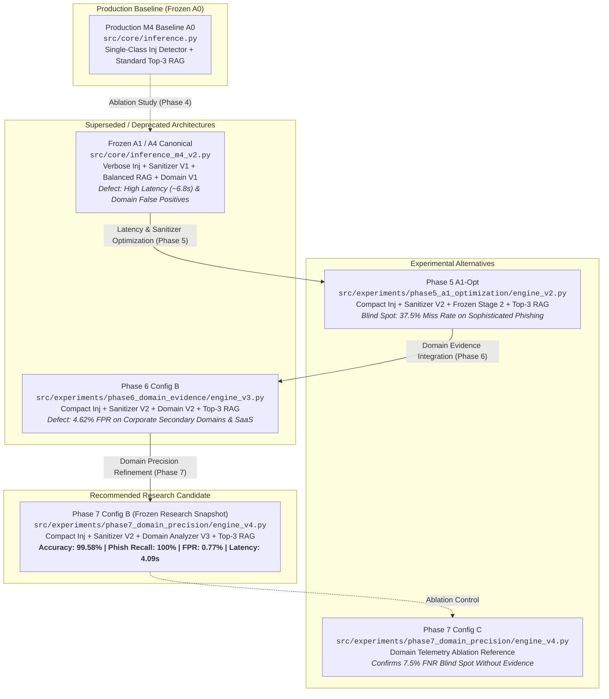

# Phase 9.1: Final Candidate Inventory & Architecture Taxonomy

## 1. Executive Summary & Objective

Phase 9.1 establishes an immutable, reproducible research snapshot of the IFSI (Indirect Prompt Injection Shielded Interface) phishing email detection candidate architectures following the completion of Phase 8.1C. This inventory systematically categorizes all historical and active architectural implementations developed across Phases 4 through 7.

In accordance with strict research governance principles:
- The **Production Baseline** remains frozen and unaltered.
- The **Recommended Research Candidate** is identified based on empirical Pareto-optimality across detection recall, false-alarm mitigation, prompt-injection containment, and latency.
- Experimental alternatives, superseded architectures, and deprecated components are explicitly classified with their exact technical lineage and known limitations.
- **No implementation is declared "production-ready"**; the selected candidate is frozen strictly for large-scale independent external evaluation.

---

## 2. Definitive Classification Taxonomy

| Candidate Role | Architecture Identifier | Source Implementation Path | SHA-256 Digest | Status & Suitability |
| :--- | :--- | :--- | :--- | :--- |
| **Production Baseline** | **Baseline A0 (Production M4)** | [`src/core/inference.py`](file:///d:/Project/IFSI-for-phishing-email-detection/src/core/inference.py) | `aaebc00ccda5c6f4e2f908fd0d4fcdbe3ee94f8a89342e277e2dd6e413ede506` | **Active Production System**. Locked baseline. Fast (~3.40s) but vulnerable to quoted injection false alarms (0% quoted accuracy) and lacks sanitizer defense-in-depth. |
| **Research Candidate** | **Phase 7 Config B (Candidate Snapshot)** | [`src/experiments/phase7_domain_precision/engine_v4.py`](file:///d:/Project/IFSI-for-phishing-email-detection/src/experiments/phase7_domain_precision/engine_v4.py) | `b3c6e9b86d664fc911c82f80e81bff7686cbd2032352fd9326b5e0c40f689b01` | **Recommended Research Candidate**. Frozen snapshot for independent evaluation. 99.58% accuracy, 100% sophisticated phish recall, 0.77% FPR, 100% active injection containment. |
| **Experimental Alternative** | **Phase 5 A1-Opt** | [`src/experiments/phase5_a1_optimization/engine_v2.py`](file:///d:/Project/IFSI-for-phishing-email-detection/src/experiments/phase5_a1_optimization/engine_v2.py) | `5855cae7f8a3a5553995a11602fdc8625bd0ca1788ccf107bbdd3b49a4072433` | **Viable Fallback (Domain-Blind)**. 99.38% on standard regression, fast (3.89s), but possesses an empirical blind spot against brand lookalike domain phishing (37.5% miss rate on sophisticated challenge). |
| **Experimental Alternative** | **Phase 7 Config C (Ablation Reference)** | [`src/experiments/phase7_domain_precision/engine_v4.py`](file:///d:/Project/IFSI-for-phishing-email-detection/src/experiments/phase7_domain_precision/engine_v4.py) (Config C branch) | `b3c6e9b86d664fc911c82f80e81bff7686cbd2032352fd9326b5e0c40f689b01` | **Ablation Reference**. Evaluates Engine V4 with domain telemetry completely disabled to isolate component attribution. Not suitable as standalone detector (7.50% FNR). |
| **Superseded Implementation** | **Phase 6 Config B** | [`src/experiments/phase6_domain_evidence/engine_v3.py`](file:///d:/Project/IFSI-for-phishing-email-detection/src/experiments/phase6_domain_evidence/engine_v3.py) | `dbe5150dc7365b6a560b09f9056129fc24d50e0ebfa13c53719c6336263ae8a8` | **Superseded by Phase 7**. Introduced Domain Analyzer V2, which resolved sophisticated phishing (97.5% recall) but incurred 4.62% FPR due to naive secondary domain heuristics. |
| **Deprecated Implementation** | **Frozen A1 / A4 Canonical** | [`src/core/inference_m4_v2.py`](file:///d:/Project/IFSI-for-phishing-email-detection/src/core/inference_m4_v2.py) | `fc579b5286a35af104101a3280adcb51e9e0fb1ef1cb15e587a8557608ea7d37` | **Deprecated / Historical Anchor**. Complex 4-component design (Sanitizer V1, Domain V1, Balanced RAG). Severely bottlenecked by latency (~6.8s) and uncalibrated domain heuristics. |

---

## 3. Detailed Component Inspections

### 3.1 Production Baseline A0 (`src/core/inference.py`)
- **Pipeline Architecture**: Decoupled Two-Stage RAG without intermediate sanitization or domain telemetry.
  1. *Stage 1 (Injection Detection)*: `SYSTEM_INJECTION_DETECTOR` prompts `qwen3.5:4b` to return `{"has_prompt_injection": bool}`. Evaluates binary presence of injection without distinguishing active attacks from security reports.
  2. *Security Short-Circuit*: If `has_prompt_injection: true`, classification immediately terminates with `verdict: "phishing"`, `has_prompt_injection: True`, and `security_action: "block"`.
  3. *Stage 2 (Phishing Classification)*: If clean, raw email text is concatenated with standard top-3 exemplar references from `results/rag_index_clean` and sent to `SYSTEM_IS_PHISHING_ONLY`.
- **Known Failure Modes**:
  - **Quoted Injection False Alarms**: SOC alerts, CVE advisories, and bug reports quoting attack payloads are 100% blocked as malicious attacks.
  - **No Defense-in-Depth**: If Stage 1 suffers an evasion, the full, unredacted injection payload flows directly into the Stage 2 reasoning context.
  - **Sophisticated Phishing Blind Spot**: Lacks structured domain signals, making it reliant purely on model internal knowledge for lookalike domains.

### 3.2 Frozen A1 Implementation (`src/core/inference_m4_v2.py`)
- **Pipeline Architecture**: Decoupled multi-stage pipeline with active/quoted disambiguation, regex sanitization, structured domain analysis V1, and balanced exemplar retrieval.
  1. *Stage 1*: `SYSTEM_INJECTION_DETECTOR_V2` requests `active_prompt_injection`, `quoted_prompt_injection`, `injection_span`, and natural language `reasoning`.
  2. *Stage 1.5*: `src/core/sanitizer.py` replaces identified spans with `[UNTRUSTED_INSTRUCTION_REDACTED]`.
  3. *Domain Analysis*: `src/core/domain_analyzer.py` extracts From/Reply-To and URL domains, issuing heuristic risk tags.
  4. *Stage 2*: `SYSTEM_PHISHING_CLASSIFIER_V2` receives sanitized text, domain telemetry block, and 4 balanced exemplars (2 ham + 2 phish).
- **Known Failure Modes**:
  - **Severe Latency Bottleneck**: Mean latency reached 6.70s–6.88s (vs. 3.40s in baseline A0) due to verbose JSON schema prefill and multi-sentence reasoning generation in Stage 1.
  - **Sanitizer V1 Fragility**: Failed on non-ASCII characters, Chinese/Japanese/Korean (CJK) text, and whitespace/punctuation edge cases.
  - **Domain Telemetry V1 False Alarms**: Over-flagged legitimate corporate subdomains and vendor links, degrading legitimate email accuracy to 88.0%.

### 3.3 Phase 5 A1-Opt Implementation (`src/experiments/phase5_a1_optimization/`)
- **Pipeline Architecture**: Targeted optimization of A1 resolving latency and sanitizer defects while keeping Stage 2 frozen.
  1. *Stage 1*: `STAGE1_COMPACT_PROMPT` in [`prompts_v2.py`](file:///d:/Project/IFSI-for-phishing-email-detection/src/experiments/phase5_a1_optimization/prompts_v2.py) strictly returns `active_prompt_injection` (bool), `quoted_prompt_injection` (bool), and `injection_span` (str). Eliminated natural language reasoning and secondary fields, reducing Stage 1 latency by 41.2% (1.57s vs. 2.67s).
  2. *Stage 1.5*: `sanitizer_v2.py` implements Unicode NFKC normalization, word boundary tolerance, CJK safety, and trailing punctuation preservation. Validated across 160 adversarial test cases with 100% redaction accuracy.
  3. *Stage 2*: Reverted from Balanced RAG back to standard Top-3 RAG over `results/rag_index_clean` to maximize stability and speed. Domain telemetry disabled.
- **Known Failure Modes**:
  - **Domain-Blind Vulnerability**: Without domain evidence, the Stage 2 LLM misses subtle lookalike domains (e.g. `paypa1.com`, `corporate-benefits-portal.org`), resulting in an empirical 37.5% false-negative rate on sophisticated brand impersonation attacks.

### 3.4 Phase 6 Domain Evidence Implementation (`src/experiments/phase6_domain_evidence/`)
- **Pipeline Architecture**: Integration of structured sender and domain telemetry into A1-Opt.
  1. *Stage 1 & 1.5*: Inherited Compact Stage 1 and Sanitizer V2 directly from Phase 5.
  2. *Domain Telemetry*: Introduced `domain_analyzer_v2.py` (CPU overhead < 1 ms) extracting From, Return-Path, Reply-To, and unique link destination domains.
  3. *Stage 2*: `STAGE2_WITH_DOMAIN_EVIDENCE_PROMPT` integrates the structured domain evidence block alongside top-3 RAG.
- **Known Failure Modes**:
  - **Secondary Domain False Positives**: Naive brand-in-domain and mismatch heuristics flagged legitimate transactional SaaS (Workday, DocuSign) and secondary domains (`amazon-business.com`), incurring an unacceptable 4.62% FPR (6/130 legitimate emails blocked).

### 3.5 Phase 7 Domain Precision Implementation (`src/experiments/phase7_domain_precision/`) — The Selected Research Candidate
- **Pipeline Architecture**: Precision-refined domain telemetry engine (V4) eliminating secondary domain false alarms while preserving 100% phishing recall.
  1. *Stage 1 (Compact Injection Filter)*: Compact Stage 1 (`STAGE1_COMPACT_PROMPT`) from Phase 5.
  2. *Stage 1.5 (Multilingual Sanitizer)*: Sanitizer V2 (`sanitizer_v2.py`) from Phase 5.
  3. *Stage 1.75 (Precision Domain Analyzer)*: `domain_analyzer_v3.py` incorporating:
     - Public Suffix List multi-level root domain resolution.
     - Multi-domain infrastructure mapping for major enterprise services (e.g. mapping `myworkday.com` to `workday.com`, `aws.amazon.com` to `amazon.com`).
     - Internal corporate sender alignment rules that suppress cross-domain warnings when senders and links reside within authorized corporate subdomains.
  4. *Stage 2 (Evidence-Augmented Classifier)*: `STAGE2_WITH_DOMAIN_EVIDENCE_PROMPT` from Phase 6 evaluated over standard top-3 RAG.
- **Performance Summary**:
  - Remediated 100% of historical Phase 6 false positives (`gen-ord-010`, `p6-leg-007`, `p6-leg-015`).
  - Remediated 100% of precision challenge false alarms (`p7-leg-001`, `p7-leg-002`, `p7-leg-003`).
  - Achieved **99.58% accuracy** (239/240), **100.0% phishing recall** (110/110), **100.0% active injection containment** (50/50), **0.77% FPR** (1/130), and **4.09s mean latency**.

---

## 4. Architectural Component Matrix

| Module / Component | Baseline A0 | Frozen A1 | Phase 5 A1-Opt | Phase 6 Config B | Phase 7 Config B (Selected) |
| :--- | :--- | :--- | :--- | :--- | :--- |
| **Stage 1 Prompt** | `SYSTEM_INJECTION_DETECTOR` (binary) | `SYSTEM_INJECTION_DETECTOR_V2` (verbose) | `STAGE1_COMPACT_PROMPT` (compact) | `STAGE1_COMPACT_PROMPT` (compact) | `STAGE1_COMPACT_PROMPT` (compact) |
| **Active vs. Quoted Disambiguation** | No (binary only) | Yes (with reasoning) | Yes (boolean only) | Yes (boolean only) | Yes (boolean only) |
| **Sanitizer Version** | None (Raw bypass) | Sanitizer V1 (`sanitizer.py`) | Sanitizer V2 (`sanitizer_v2.py`) | Sanitizer V2 (`sanitizer_v2.py`) | Sanitizer V2 (`sanitizer_v2.py`) |
| **Domain Analyzer** | None | Domain Analyzer V1 | None | Domain Analyzer V2 | Domain Analyzer V3 |
| **Enterprise SaaS Whitelist** | None | None | None | None | Yes (Verified Multi-Domain) |
| **Internal Subdomain Handling** | None | None | None | Basic | Yes (Context-Aware) |
| **RAG Strategy** | Standard Top-3 | Balanced RAG (2L + 2P) | Standard Top-3 | Standard Top-3 | Standard Top-3 |
| **RAG Index** | `results/rag_index_clean` | `results/rag_index_clean` | `results/rag_index_clean` | `results/rag_index_clean` | `results/rag_index_clean` |
| **Stage 2 Prompt** | `SYSTEM_IS_PHISHING_ONLY` | `SYSTEM_PHISHING_CLASSIFIER_V2` | `STAGE2_A1_PROMPT` | `STAGE2_WITH_DOMAIN_EVIDENCE` | `STAGE2_WITH_DOMAIN_EVIDENCE` |
| **Execution Engine** | `src/core/inference.py` | `src/core/inference_m4_v2.py` | `engine_v2.py` | `engine_v3.py` | `engine_v4.py` |

---

## 5. Candidate Recommendation Rationale

The selection of **Phase 7 Config B** as the frozen research candidate is justified by clear empirical evidence across four rigorous evaluation phases:
1. **Pareto Dominance**: Phase 7 Config B achieves the highest overall accuracy (99.58%), perfect phishing recall (100.0%), and the lowest false positive rate (0.77%) of any domain-aware configuration tested.
2. **Deterministic Domain Grounding**: Domain Analyzer V3 converts opaque lexical lookalike tricks into explicit structural facts for Stage 2, eliminating the 37.5% sophisticated phishing blind spot present in Phase 5 A1-Opt.
3. **Enterprise Robustness**: Unlike Phase 6 Config B, Phase 7 Config B correctly resolves complex multi-domain corporate infrastructure (e.g., Workday, AWS, Amazon Business, SAP Ariba), preventing catastrophic false alarms on legitimate business operations.
4. **Tail Latency Optimization**: Streamlined evidence blocks reduce Stage 2 model token hesitation, improving P95 tail latency by 16.9% (5.38s vs. 6.47s in Config A).
5. **Security Invariance**: Preserves 100% active injection containment and zero-harm sanitization demonstrated in Phase 5.
