# Phase 9.2: Cross-Phase Architectural Comparability Analysis

## 1. Comparability Framework & Methodology

A central vulnerability in applied machine learning research is comparing model versions across evaluation suites that differ in dataset volume, sample difficulty, class balance, and prompt framing. Ranking architectures by raw percentage scores derived from different benchmarks produces statistically invalid and scientifically misleading conclusions.

This analysis establishes a rigorous comparability taxonomy across all IFSI experiments from Phase 4 through Phase 7:
1. **Directly Comparable Evaluations**: Evaluated concurrently on identical samples, identical prompts/schemas (except for the isolated ablation variable), identical decoding hyperparameters (`temperature = 0.0`), and identical evaluation harnesses.
2. **Partially Comparable Evaluations**: Evaluated on shared, overlapping benchmark sub-distributions or longitudinal regression slices, but where the broader evaluation volume or auxiliary challenge tasks differ.
3. **Non-Comparable Evaluations**: Radically divergent datasets, mismatched class distributions, differing foundational model families, or distinct task definitions (e.g. classical linear bag-of-words ML vs. generative decoupled multi-stage LLM reasoning).

---

## 2. Directly Comparable Evaluation Regimes

```mermaid
flowchart TD
    subgraph Regime_P4["Phase 4 Ablation Regime (N = 250)"]
        P4_A0["Baseline A0"] <--> P4_ISO4["ISO-4"]
        P4_ISO4 <--> P4_A1["A1"]
        P4_A1 <--> P4_A2["A2"]
        P4_A2 <--> P4_A3["A3"]
        P4_A3 <--> P4_A4["A4 Canonical"]
    end

    subgraph Regime_P5["Phase 5 Optimization Regime (N = 160)"]
        P5_Frozen["Frozen A1 Baseline"] <--> P5_Opt["A1-Opt (Engine V2)"]
    end

    subgraph Regime_P6["Phase 6 Domain Evidence Regime (N = 200)"]
        P6_CfgA["Config A (A1-Opt)"] <--> P6_CfgB["Config B (Domain V2)"]
        P6_CfgB <--> P6_CfgC["Config C (Ablation)"]
    end

    subgraph Regime_P7["Phase 7 Precision Refinement Regime (N = 240)"]
        P7_CfgA["Config A (P6 Baseline)"] <--> P7_CfgB["Config B (Domain V3)"]
        P7_CfgB <--> P7_CfgC["Config C (Ablation)"]
    end
```

### 2.1 The Phase 4 Controlled Ablation Cohort ($N = 250$)
- **Benchmark Corpus**: Exactly 250 emails (`live_benchmark_v2.jsonl` $N=150$ + `heldout_benchmark_v1.jsonl` $N=100$).
- **Directly Comparable Set**: All 9 configurations (`A0`, `ISO-4`, `A1`, `A2`, `A3`, `A4`, `ISO-1`, `ISO-2`, `ISO-3`).
- **Controlled Conditions**:
  - Exact same 250 emails presented in identical order.
  - Constant local model engine: `qwen3.5:4b`, greedy decoding (`temperature = 0.0`, `num_predict = 512`).
  - Paired sample-by-sample McNemar tests and exact contingency tables.
- **Empirical Takeaway**:
  - Proved canonical parity between modular engine (A3) and reference (A4) with zero discordant predictions ($p = 1.000$).
  - Proved that fine-grained injection classification eliminated quoted injection false alarms without degrading baseline phishing recall.
  - Demonstrated that Domain Telemetry V1 was prematurely integrated, producing 23 harmful shifts due to uncalibrated heuristics on synthetic domains.

### 2.2 The Phase 5 Latency Optimization Cohort ($N = 160$)
- **Benchmark Corpus**: `data/evaluation/phase5_regression_160.jsonl` ($N=160$).
- **Directly Comparable Set**: Frozen A1 (`src/core/inference_m4_v2.py`) vs. Optimized A1 (`src/experiments/phase5_a1_optimization/engine_v2.py`).
- **Controlled Conditions**:
  - Evaluated on identical 160 regression cases (100 injection cases: 50 active injection stress tests + 50 quoted SOC alert discussions; plus 60 standard regression emails: 40 legitimate, 20 sophisticated phishing).
  - Both configurations operated over the exact same clean FAISS index.
- **Empirical Takeaway**:
  - Exact prediction invariance: Exactly **zero predictions changed** between Frozen A1 and A1-Opt across all 160 emails (both scored 87.50% accuracy).
  - Sanitizer V2 achieved 100% boundary safety on non-ASCII/CJK text across all 50 active injection cases and 11 unit tests, while safe-delivering 100% (50/50) of quoted incident alerts.
  - Stage 1 prompt compaction achieved a true **41.2% latency reduction (1.57s vs. 2.67s)** with zero classification compromise. Hardware accelerator device is UNVERIFIED (host compute device not logged in prediction records).
  - Both models failed 100% (20/20) of sophisticated phishing emails, exposing the domain-blind vulnerability.

### 2.3 The Phase 6 Domain Evidence Cohort ($N = 200$)
- **Benchmark Corpus**: Combined 200 emails (`phase5_regression_160` $N=160$ + `phase6_domain_challenge` $N=40$).
- **Directly Comparable Set**: Config A (A1-Opt Baseline) vs. Config B (A1-Opt + Domain Analyzer V2) vs. Config C (Domain Evidence Ablation).
- **Controlled Conditions**:
  - Both configurations shared identical compact Stage 1 prompts and Sanitizer V2.
  - The only isolated independent variable was the injection of `[STRUCTURED SENDER & DOMAIN EVIDENCE]` into Stage 2.
- **Empirical Takeaway**:
  - Config B resolved the sophisticated phishing blind spot, increasing sophisticated recall from 45.0% to **100.0%** (+55.0 pp net gain on lookalike pretexts).
  - Simultaneously exposed the secondary domain defect: Config B introduced 3 false positives (2.73% FPR) on legitimate corporate workflows (`amazon-business.com`, Workday, Concur).
  - Config C Ablation & Parity: Removing domain evidence resulted in 22 missed phishing samples. On the 40 challenge samples, Config C achieved 97.5% prediction parity with Config A (39/40 identical); sample `p6-sop-016` flipped from `false` (Config A) to `true` (Config C) due to decision boundary sensitivity near threshold and floating-point summation variation across separate sessions.

### 2.4 The Phase 7 Domain Precision Cohort ($N = 240$)
- **Benchmark Corpus**: Combined 240 emails (`phase5_160` + `phase6_40` + `phase7_precision_challenge` 40).
- **Directly Comparable Set**: Config A (Phase 6 Baseline with Domain Analyzer V2) vs. Config B (Research Candidate with Domain Analyzer V3) vs. Config C (Ablation with Domain Evidence Disabled).
- **Controlled Conditions**:
  - Synchronous 560-prediction run on identical inputs.
- **Empirical Takeaway**:
  - Config B achieved statistically superior precision over Config A: FPR dropped from 4.62% (6 FPs) to **0.77% (1 FP)**, achieving an **83.3% relative reduction in false positives**.
  - Remediated 100% of historical Phase 6 false positives and 100% of new SaaS challenge false positives while preserving 100.0% phishing recall (60/60 detected).
  - Quoted Injection Handling: Config B safe-delivered 49 of 50 quoted security reports (98.0%), with exactly one false positive on `gen-inj-071` where Stage 2 LLM tripped on attack vocabulary despite clean domain evidence.
  - Tail Latency & Compute Device: P95 tail latency dropped by 16.9% (5.38s vs. 6.47s); execution hardware device is UNVERIFIED in prediction metadata.

---

## 3. Partially Comparable Evaluation Regimes

Partially comparable evaluations share core architectural lineage or sub-dataset partitions, but cannot be directly contrasted on raw aggregate percentages:

| Comparison Contrast | Shared Baseline Elements | Divergent Factors | Valid Inferences | Invalid Inferences |
| :--- | :--- | :--- | :--- | :--- |
| **Phase 5 ($N=160$) vs. Phase 6 ($N=200$) vs. Phase 7 ($N=240$)** | The 160 regression emails from Phase 5 are preserved as an exact, unmutated subset in Phase 6 and Phase 7. | Phase 6 added 40 lookalike challenge emails; Phase 7 added 40 multi-tenant SaaS precision emails. | We can track performance **specifically on the 160-sample slice**: Config B in Phase 7 scored 99.38% on this slice (remediating `gen-ord-010`), proving longitudinal stability. | Comparing overall benchmark accuracy (87.50% in P5 vs. 96.50% in P6 vs. 99.58% in P7) as evidence of general improvement is invalid because each benchmark's difficulty and class mix differed. |
| **Live Benchmark V1 ($N=50$) vs. Live Benchmark V2 ($N=150$)** | V1 provided the original seed templates for active prompt injections. | V2 added 100 difficult enterprise emails and introduced quoted injection SOC reports. | Confirms that early prompt injection defenses in V1 degraded when exposed to quoted incident reports in V2. | Stating that M4 accuracy dropped from 94.0% in V1 to 91.3% in V2 represents a "model regression" is invalid; V2 tested a fundamentally harder distribution. |
| **A1 Generalization ($N=500$) vs. Phase 7 Precision ($N=240$)** | Both evaluate A1-lineage prompt injection handling. | A1 Generalization evaluated 200 diverse prompt injections across academic/red-team datasets; Phase 7 focused on domain lookalikes and SaaS authentication. | Confirms that Sanitizer V2 and compact prompting maintained 100% active injection containment across both distributions. | Cross-comparing overall accuracy (93.4% vs. 99.58%) is invalid due to disjoint sample compositions. |

---

## 4. Non-Comparable Evaluation Regimes

The following comparisons represent fundamentally incompatible empirical regimes. Juxtaposing their scores directly is scientifically invalid:

### 4.1 Classical ML (M1) vs. Multi-Stage Generative LLM (M4 / Config B)
- **Architecture M1**: Classical bag-of-words TF-IDF vectorizer + Logistic Regression ($\tau = 0.29$) trained on 1,321 clean email vectors.
  - Zero context window; zero generative capability.
  - Intrinsically immune to prompt injection (does not follow instructions), but completely unable to parse natural language nuance, perform multi-step reasoning, or evaluate quoted text.
- **Architectures M4 & Config B**: Multi-stage generative reasoning pipelines using `qwen3.5:4b` with decoupled prompt injection shielding and vector RAG.
- **Why Non-Comparable**: M1 and M4 solve different operational problems. M1 is a lightweight feature baseline; M4 is an autonomous semantic analyzer. Claiming "Config B is 5% more accurate than M1" obscures the fact that M1 has 0 ms LLM latency and 0% vulnerability to jailbreaks, while Config B provides deep structural explainability.

### 4.2 Phase 4–7 Controlled Challenge Suites vs. Phase 8 Track A Real-World Email Corpora
- **Phases 4–7 Challenge Suites**: Carefully constructed, targeted stress tests ($N = 40$ to $N = 500$) designed to probe specific failure modes (boundary whitespace, CJK Unicode characters, quoted CVE advisories, brand lookalike domains, multi-tenant SaaS authentication).
  - Class balances were artificially enriched (e.g. 50% phishing, 25% injection).
- **Phase 8 Track A Target Corpora**: Raw, uncurated enterprise and operational mail archives (IETF mailing lists, Apache Software Foundation archives, TREC 2007, Phishing Pot captures).
  - Real-world class distribution is heavily skewed toward legitimate traffic ($> 95\%$ legitimate in operational mailboxes).
  - Real-world mail contains transport header anomalies, broken MIME boundaries, multipart HTML noise, and threading reply chains.
- **Why Non-Comparable**: A 99.58% score on a 240-email curated challenge suite **provides zero statistical proof of a 99.58% score on real-world mail streams**. Conflating the two constitutes an unjustified generalization claim.

---

## 5. Summary Matrix of Cross-Phase Comparability

| Evaluation Pair | Comparability Tier | Legitimate Comparative Use | Prohibited / Misleading Use |
| :--- | :---: | :--- | :--- |
| **Phase 4 A0 vs. A1 vs. A4** | **DIRECT** | Paired McNemar testing of modular component attribution on $N=250$. | Extrapolating ablation latency to production deployment without verifying compute device or hardware tuning. |
| **Phase 5 Frozen A1 vs. A1-Opt** | **DIRECT** | Quantifying Stage 1 latency speedup (-41.2%) and sanitizer boundary safety on $N=160$. | Claiming A1-Opt is complete when both models missed 100% of lookalike phishing. |
| **Phase 6 Config A vs. Config B** | **DIRECT** | Quantifying the net recall gain of structured domain evidence (+55.0 pp) and identifying SaaS false positives. | Claiming Config B is production-ready despite a 2.73% false positive rate. |
| **Phase 7 Config A vs. Config B** | **DIRECT** | Demonstrating that Domain Analyzer V3 remediated 100% of historical and SaaS challenge false positives. | Declaring the entire phishing detection problem "solved" based on 240 samples. |
| **Phase 5 Slice across P5 $\to$ P6 $\to$ P7** | **PARTIAL** | Tracking longitudinal stability and remediation of specific sample IDs (`gen-ord-010`). | Computing an aggregate or average score across the 160, 200, and 240 benchmarks. |
| **M1 ML Baseline vs. Config B LLM** | **NON-COMPARABLE** | Contrasting classical linear classification vs. multi-stage semantic reasoning. | Direct leaderboard accuracy ranking without noting latency and compute disparity. |
| **Phase 7 Config B vs. Phase 8 Track A** | **NON-COMPARABLE** | Establishing Phase 7 Config B as the frozen candidate to be evaluated on Track A. | Claiming Phase 7's 99.58% challenge score predicts Track A real-world accuracy. |
