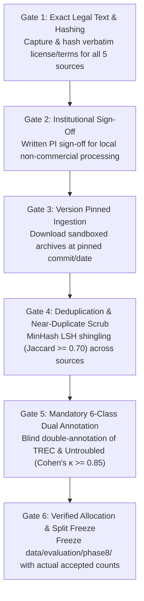

# Phase 9.2: Independent Evaluation Feasibility & Allocation Status Audit

## 1. Resolution of the Phase 8.1C vs. Phase 9.1 Allocation Inconsistency

> [!CRITICAL]
> **Mandatory Resolution on Evaluation Allocations**:
> In the Phase 9.1 audit report, references were made to a proposed Track A evaluation allocation of **$N = 600$ Test ($300\text{L} + 300\text{P}$)** and **$N = 200$ Validation ($100\text{L} + 100\text{P}$)** as if it were an established target ready for ingestion.
>
> A rigorous audit of the underlying primary Phase 8.1C deliverables—specifically [`phase8_1c_final_decision.md`](file:///d:/Project/IFSI-for-phishing-email-detection/results/phase8_independent_evaluation/phase8_1c_final_decision.md), [`phase8_1c_revised_allocation.md`](file:///d:/Project/IFSI-for-phishing-email-detection/results/phase8_independent_evaluation/phase8_1c_revised_allocation.md), and [`phase8_1c_trec_label_validity_audit.md`](file:///d:/Project/IFSI-for-phishing-email-detection/results/phase8_independent_evaluation/phase8_1c_trec_label_validity_audit.md)—establishes the following definitive conclusion:
>
> 1. The $N=600$ test and $N=200$ validation numbers were **NEVER APPROVED, AUTHORIZED, OR FEASIBLE**.
> 2. They were strictly **Provisional Statistical Targets Conditional on Valid Source Acquisition and Annotation**.
> 3. The formal, binding Phase 8.1C governance decision is:
>    > **`No defensible acquisition design is currently feasible.`**
> 4. Zero real-world emails have been downloaded, ingested, pre-processed, or split.
> 5. **Independent evaluation remains strictly BLOCKED and UNAUTHORIZED.**

---

## 2. Evidence-Based Audit of Underlying Source Constraints

A forensic review of the five candidate sources shortlisted during Phase 8.1B and audited in Phase 8.1C reveals five insurmountable barriers that currently prevent acquisition:

### 2.1 The TREC 2007 Native Label Fallacy (`trec07p`)
- **Corpus Metadata**: `trec07p` contains 75,419 total messages collected between April 8 and July 6, 2007 (25,220 `ham` and 50,199 `spam`).
- **The Core Scientific Defect**: TREC 2007 was designed as an anti-spam competition corpus. Its native gold standard is binary **`ham` versus `spam`**.
- **`spam` $\neq$ Phishing**:
  - Mid-2007 unsolicited commercial spam was dominated by bulk pharmaceutical advertisements, luxury replica solicitations, online casino marketing, mortgage refinancing spam, SEO link building, and PDF/GIF stock-pump manipulations.
  - **None of these constitute phishing**. Phishing strictly requires deceptive authority/brand impersonation coupled with credential theft (`C1`) or financial fraud/wire diversion (`C2`).
  - Native phishing labels **do not exist** in TREC 2007.
  - The Phase 8.1B assumption of extracting $120\text{ test} + 30\text{ val} = 150$ verified phishing emails from TREC 2007 was based on zero empirical message-level evidence.
  - Phase 8.1C rejected this quota. The number of genuine phishing campaigns in TREC 2007 remains **completely unknown** pending authorized acquisition and manual dual-annotation.

### 2.2 Untroubled.org Spam Trap Archive
- **Corpus Metadata**: Long-running raw honeypot spam archive maintained by Bruce Guenter (`1998–present`).
- **The Core Defect**: Untroubled is an indiscriminate spam-trap collection. Over 95% of its volume consists of archaic bulk marketing, bounce chatter, and commercial junk mail.
- **Label Status**: Zero native phishing labels. The proposed allocation of $30\text{ test} + 10\text{ val} = 40$ phishing messages is an unsupported estimate that cannot be accepted without message-level human annotation.

### 2.3 `phishing_pot` Versioning & Third-Party Licensing
- **Corpus Metadata**: Contemporary GitHub repository (`rf-peixoto/phishing_pot`) aggregating `.eml` phishing captures (`2022–2025`).
- **The Core Defect**:
  - Pinned commit SHA-256 has not been frozen.
  - While repository metadata indicates `CC BY-NC 4.0`, compiler copyright under `17 U.S.C. § 103(b)` does not clear underlying third-party trademarks, copyrighted HTML templates, or sender content embedded in captured phishing lures.
  - Written institutional/PI sign-off for local non-commercial research processing has not been executed.
  - Post-deduplication usable yield ($225\text{ test} + 75\text{ val} = 300$) remains an unverified estimate.

### 2.4 IETF & Apache Software Foundation Mail Archives
- **Corpus Metadata**: Public technical mailing list archives (`mailarchive.ietf.org` and `lists.apache.org`).
- **The Core Defect**:
  - While public-record frameworks (IETF Trust / Note Well and ASF Public Forum Policy) exist, exact reuse terms and institution-specific local processing boundaries have not been captured or hashed.
  - The proposed legitimate quotas ($105\text{ test} + 35\text{ val}$ for IETF; $90\text{ test} + 30\text{ val}$ for ASF) represent rough estimates that have not been validated against campaign/thread deduplication, bot filtering, or list-header stripping.

### 2.5 Severe Source-Only Confounding ($BA^*_{\text{source-only}} = 0.9250$)
- In the proposed conditional $600 + 200$ design, four of the five candidate sources are monovalent (single-class):
  - `phishing_pot`: 100% phishing (225 test / 75 val)
  - `Untroubled.org`: 100% phishing (conditional: 30 test / 10 val)
  - `IETF`: 100% legitimate (105 test / 35 val)
  - `ASF`: 100% legitimate (90 test / 30 val)
- Only TREC 2007 was proposed as a dual-class anchor (105 legitimate + 45 phishing in test).
- Because single-class sources represent 75% of the corpus, the Bayes-optimal source-only classifier achieves a balanced accuracy defined by:
  $$\text{BA}^*_{\text{source-only}} = \frac{1}{N} \sum_{s \in S} \max(n_{s,0}, n_{s,1}) = \frac{225 + 30 + 105 + 90 + 105}{600} = \frac{555}{600} = 0.9250$$
- A naive classifier that simply identifies which mail server or list format generated the email would achieve 92.50% balanced accuracy without inspecting any phishing intent or payload semantics.
- Pooled aggregate metrics on such a design would be statistically uninterpretable and scientifically misleading without mandatory source-stratified evaluation.

---

## 3. Current Feasibility Status: BLOCKED

The current operational status of the large-scale independent evaluation across all tracks is summarized below:

| Track Identifier | Proposed Scope | Current Status | Primary Blockers |
| :--- | :--- | :---: | :--- |
| **Track A: Independent Real-Email Evaluation** | $N = 600$ Test / $N = 200$ Val across 5 external real-world sources | **BLOCKED** | 1. Zero sources legally cleared with hashed license texts. 2. Zero native phishing labels in TREC and Untroubled. 3. Unverified deduplicated yields. 4. High source-only confounding ($\text{BA}^* = 0.925$). |
| **Track B1: Synthetic Email Challenge** | $N = 800$ Out-of-Distribution email attacks (BEC, multi-turn injections) | **ON HOLD** | Dependent on completion of Track A governance framework to prevent data pollution. |
| **Track B2: Non-Email Standalone Injection** | $N = 200$ Raw documents, source code, and JSON configuration files | **ON HOLD** | Segregated benchmark; out of scope until Track A status is formally resolved. |

---

## 4. Conditions Required to Unblock Independent Evaluation

Before any large-scale independent evaluation can be authorized or executed, the following six strict gates must be passed:

1. **Gate 1: Capture & Cryptographic Hashing of Exact Legal Terms**:
   - Capture verbatim policy and usage agreement texts with SHA-256 digests from:
     - Waterloo TREC 2007 usage agreement.
     - `phishing_pot/LICENSE` at a pinned Git commit hash.
     - `untroubled.org/spam/` policy notice.
     - IETF Trust Legal Provisions (TLP) and Note Well terms.
     - ASF Public Forum Archive Policy.
2. **Gate 2: Formal Written Institutional Sign-Off**:
   - Written confirmation that local hosting, feature extraction, and non-commercial model evaluation comply with applicable institutional policies, fair-use standards (`17 U.S.C. § 107`), and data protection laws.
   - Enforce `redistribution_allowed: false` across all ingested emails.
3. **Gate 3: Pinned Archive Retrieval & Sandbox Ingestion**:
   - Ingest archives into isolated, git-ignored local staging directories (`data/raw/phase8_track_a/`).
   - Prohibit external network connections during feature extraction, and prohibit rendering HTML/active attachments.
4. **Gate 4: Cross-Source Deduplication & Contamination Auditing**:
   - Execute MinHash LSH shingling ($\text{Jaccard} \ge 0.70$) to eliminate duplicate spam campaigns, shared templates, and historical IFSI contamination (Enron, Nazario, SpamAssassin).
5. **Gate 5: Independent Dual-Analyst 6-Class Annotation Protocol**:
   - Every candidate message drawn from TREC 2007 or Untroubled.org must be labeled using the 6-class taxonomy:
     - `C1`: Credential theft / brand impersonation (Phishing)
     - `C2`: Financial fraud / wire diversion / impersonation (Phishing)
     - `C3`: Malware delivery (Excluded from binary benchmark)
     - `C4`: Ordinary unsolicited commercial bulk spam (Excluded from binary benchmark)
     - `C5`: Verified legitimate correspondence (Legitimate)
     - `C6`: Ambiguous / unresolvable intent (Quarantined)
   - Two blind annotators must independently review each sample without seeing model verdicts.
   - Hard inter-annotator agreement threshold: **Cohen's $\kappa \ge 0.85$** on binary polarity (`C1/C2` vs. `C5`).
6. **Gate 6: Recomputed Usable Yields & Allocation Freeze**:
   - Only after accepted, deduplicated, and audited class counts are finalized can a test and validation split be frozen under `data/evaluation/phase8/`.
   - If accepted phishing counts fall short of targets, the benchmark size must be reduced; **under no circumstances may ordinary commercial spam (`C4`) be reclassified as phishing**.
